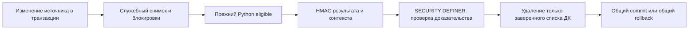

# Техресурс — шаг 33: ограниченное обслуживание ДК, изолированный прототип

Дата: 19.10.2026, Asia/Yekaterinburg.
Проект: C:/Projects/excel-ai-agent-8001.
Рабочая БД/схема: ai_excel_agent_test/test_construction_identity_stage46.

**Прототип проверен только в отдельном временном PostgreSQL. Приложению не выдано UPDATE/DELETE production_matrix_dk. Рабочая схема, роли, grants, триггеры, код расчётов и сервер 8001 не изменены.**

## Исходная логика и условия

Производственный вызов matrix_dk.reconcile найден в MatrixConnection._reconcile_dk. Он вызывается перед commit(), а также перед выходом из transaction(), поскольку psycopg может выполнять COMMIT без вызова Python commit(). Reconcile выполняется только в активной транзакции с локальным признаком tehresurs.dk_calendar_dirty=1.

Признак устанавливается триггерами изменений employees, positions, employee_movements, rail_tickets, employee_sick_periods, employee_luvr_day_overrides, employee_duration_exceptions и employee_absences. Исходный reconcile берёт pg_advisory_xact_lock(20261017,29), блокирует все существующие отметки ДК и проверяет каждую существующим eligible().

Отметка остаётся, только если одновременно:
- сотрудник найден, его должность в точности «Инженер ПИЛ (НК, УЗК)», сотрудник не архивный;
- существующий calculate_employee_day на исходных календарных данных возвращает FULL либо HALF;
- на дату нет записи employee_absences с включающими эту дату границами.

Если любой пункт не выполняется, исходный алгоритм удаляет отметку. Даты увольнения, болезни, поездки, движения, ручные корректировки и график учитывает прежний календарь. Участие в месяце ЛУВР проверяется при ручном создании set_event, но не является дополнительным условием удаления в reconcile. Прототип не добавляет такого условия.

Ручной set_event имеет собственный DELETE и проверку LEADER; он не заменён служебной операцией. HTTP-политики ручного назначения/отмены ДК для двух ролей не расширялись.

## Почему не функция delete(employee_id,date,is_invalid)

SECURITY DEFINER сам по себе не доказывает устаревание: принимаемый от SQL-клиента флаг можно подделать. Полная пригодность сейчас вычисляется Python-календарём. Его переписывание на SQL создало бы второй алгоритм с риском расхождения. Выбран прототип с доверенным подтверждением результата именно существующего eligible(), без переноса календарных правил.

Модель угроз: произвольный SQL исполняется с кандидатной ролью приложения, но без доступа к ключу и памяти доверенного серверного Python-компонента. Компрометация самого подписывающего кода, ключа, администратора PostgreSQL или ОС **не покрывается** этим доказательством. Это существенное дополнительное доверие, которое необходимо отдельно принять перед внедрением.

## Выбранный механизм

В частной схеме dk_service установлены два доступных кандидату входа:
1. snapshot() берёт прежний advisory lock, блокирует строки ДК и возвращает их список и контекст.
2. prune(text[],bytea) заново получает актуальный контекст и принимает список только с корректным HMAC-SHA256.

Контекст привязан к pg_backend_pid(), txid_current() и SHA256 состояния всех восьми календарных таблиц и production_matrix_dk. Хешируются все строки/столбцы, порядок фиксирован COLLATE C, timezone=UTC и ISO DateStyle. Ключи отметок канонизируются как employee_id:YYYY-MM-DD и сортируются. Не принимаются произвольные SQL-идентификаторы, выражения, признаки пригодности или динамический SQL. Подпись сравнивается по всем 32 байтам без раннего выхода при несовпадении.

Доверенный Python prepare() получает снимок и для каждой отметки вызывает **тот же app.services.matrix_dk.eligible(conn,...)**. Подписывается только полученный список непригодных отметок; публичного интерфейса «подпиши переданный список» нет. Новый алгоритм календаря/распределения времени не реализовывался.

Список отметок, состояние источника, соединение или транзакцию нельзя заменить, сохранив прежнюю подпись. Изменение источника после вычисления подписи приводит к отказу и откату, не к частичному удалению. При отсутствии/повреждении ключа или неверном доказательстве действует fail-closed. Неподдерживаемая изоляция транзакции также даёт отказ; прототип допускает READ COMMITTED. Найденные REPEATABLE READ-пути матрицы/ВОУ — READ ONLY и не обслуживают dirty-транзакции.

Исходный алгоритм обходит все ДК, поэтому и прототип может убрать ранее устаревшую отметку другого сотрудника; это прежняя глобальная семантика. Пригодные отметки других сотрудников/дат остаются.

## Служебные полномочия

Владелец установлен один раз при создании и не определяется вызывающим пользователем: iso_dk_owner_f71a0b1850d94f41a29a480af2c119f5. Для будущего рабочего применения предлагается отдельное имя tehresurs_8001_dk_owner, только после согласования.

Владелец:
- NOLOGIN, NOINHERIT; нет SUPERUSER, CREATEDB, CREATEROLE, REPLICATION, BYPASSRLS;
- не владеет рабочими таблицами; SELECT только на восемь источников и ДК;
- UPDATE(work_date) на ДК исключительно для FOR UPDATE и DELETE только на ДК;
- владеет закрытой служебной схемой, таблицей ключа и тремя собственными функциями;
- EXECUTE только необходимого hmac(bytea,bytea,text) расширения pgcrypto.

Кандидатная роль приложения:
- прежний SELECT ДК;
- дополнительно USAGE dk_service и EXECUTE только snapshot()/prune();
- **нет UPDATE, DELETE, INSERT ДК**, членства в роли владельца, CREATE в служебной схеме, доступа к таблице ключа или внутреннему context().

PUBLIC не имеет USAGE служебной схемы и EXECUTE её функций. search_path функций фиксирован: pg_catalog, dk_service, pg_temp; рабочие таблицы и таблица ключа указаны с полными именами. Это соответствует требованиям PostgreSQL к безопасной реализации [SECURITY DEFINER](https://www.postgresql.org/docs/18/sql-createfunction.html#SQL-CREATEFUNCTION-SECURITY). HMAC выполняется стандартным [pgcrypto](https://www.postgresql.org/docs/18/pgcrypto.html), а в Python — hmac/hashlib.

Служебная таблица содержит единственный случайный 256-битный ключ, доступный владельцу. Кандидат не может его читать/менять. В испытаниях вторая копия ключа передана доверенному Python через stdin ограниченного worker, не через SQL/GUC, CLI, исходный код или публичный API. Ключ не включён в report.json. Только тестовая роль фикстур дополнительно получила INSERT/DELETE таблицы ключа для испытания отсутствующего ключа; это не полномочия кандидата и не часть будущего runtime-плана.

Расширение, схема и владелец создавались только в собственном кластере. Установщик отказывает для имени БД вне auth_stage3_*; его нельзя просто применить к рабочей БД. При RLS на целевой схеме прототип также отказывает, требуя отдельного анализа. Изменений существующего рабочего pgcrypto или общего PostgreSQL не было.

## Файлы и граница интеграции

Новые:
- backend/scripts/dk_service_prototype.py — изолированный установщик и prepare/reconcile с подписью;
- backend/tests/test_dk_service_prototype.py — десять сценариев;
- backend/docs/auth-step33-dk-maintenance-2026-10-19.md — настоящий отчёт.

Изменены только тестовая инфраструктура:
- backend/scripts/run_auth_isolated.py — устанавливает прототип в временной stage3-копии и создаёт ключ только для неё;
- backend/scripts/auth_test_worker.py — запускает новый набор и передаёт тестовую конфигурацию в памяти.

SignedConnection определён **в тесте**, наследует прежний MatrixConnection и вызывает прототип только при dirty=1. app/database/db.py, matrix_dk.py, календарь, матрица, ВОУ, HTTP-политики и действующий launcher не изменены. Новые функции не опубликованы HTTP-маршрутами. Старый блокирующий сценарий шага 32 по-прежнему проверяется на обычном MatrixConnection; это подтверждает отсутствие скрытого переключения.

## Итоги тестирования

Окончательный прогон:
backend/output/security/auth_isolated/20261019T041933Z_e3c927cdfb79451dacfce66613dc0c90/report.json

**52 успешных интеграционных теста, 0 неуспешных:** 42 предыдущих и 10 новых сценариев. Полный набор: 8 структуры, 11 сессий, 23 политик/запуска/роли, 10 прототипа ДК. Это не означает исполнение всех старых фикстур под новой ролью: setup использует отдельную ограниченную инфраструктурную роль, действия прототипа — кандидатную.

Новые сценарии:
1. Изменение ФИО не удаляет пригодный ДК; архивное состояние в тестовой копии удаляет только отметки ставшего непригодным сотрудника.
2. HALF сохраняет отметку; TRAVEL удаляет только конкретную дату; отсутствие с включающими границами удаляет отметку этой даты. Другой сотрудник сохраняется.
3. Вставка PARSED-билета не отменяет пригодный ДК. Изменение времен уже подтверждённого тестового билета и соответствующего движения меняет календарный день и удаляет только устаревшую отметку. Подтверждённый билет — fixture; HTTP-право подтверждения не добавлено.
4. Прямые DELETE/UPDATE ДК, чтение ключа, внутренний context(), SET ROLE владельца и prune с поддельной подписью отклонены.
5. Подмена списка, изменение источника после подписи, повтор в новой транзакции и другом соединении отклонены.
6. Ошибка после уже выполненной служебной очистки откатывает одновременно календарный источник и удаление ДК.
7. Отсутствующий ключ приводит к отказу; имя сотрудника и отметки сохраняются после отката.
8. Проверены NOLOGIN/административные флаги владельца, отсутствие UPDATE/DELETE у кандидата, закрытый PUBLIC EXECUTE и безопасный search_path.
9. Снимок блокирует конкурирующего календарного писателя: попытка второго соединения завершилась lock_timeout, данные/отметки не изменились.
10. На одинаковых изменениях во временной копии **полностью совпали** матрица (включая ЛУВР/дневные ячейки/итоги) и результат чистой подготовки ВОУ prepare_data после исходного reconcile и после прототипа.

Проверка результата использует тестовый январь 2030 и прежние calculate_month/prepare_data, без второго распределителя времени. Это не новый производственный расчёт октября 2026 и не открытие COM/XLSM/проверка печати. Архивы и исходные факты/назначения не переписывались. Проверка FULL/HALF и остальных условий использует существующий eligible(), поэтому логика пригодности не копировалась в SQL.

До окончательного прогона выполнены две успешные промежуточные итерации: базовые сценарии, затем fail-closed и ACL; после добавления конкуренции повторён полный набор. Их журналы сохранены. Во всех прогонах рабочие отпечатки совпали.

## Риски и границы доказательства

- **Ключ — полномочие доверенного компонента.** Если ключ украден или серверный код подписывает заведомо ложный список, SQL-функция не пересчитает календарь независимо и может удалить пригодный ДК. Прототип доказывает защиту от SQL-кандидата без ключа, не от компрометации подписывающего процесса. Это нельзя скрывать за названием SECURITY DEFINER.
- Перед применением требуется отдельная схема хранения/ротации второй копии ключа, например отдельный DPAPI blob; ключ не должен попадать в окружение пользователей, логи, GUC, SQL-код, ответы API или обычные резервные копии. Закрытая таблица ключа также требует защиты резервных копий. На рабочем сервере ключ не создавался.
- Источник и версия подписывающего кода должны быть доверенными; при появлении новых календарных зависимостей необходимо обновлять набор данных контекста и повторять доказательство/тесты.
- Полное хеширование девяти таблиц под общим lock добавляет стоимость. Нагрузочное испытание большого объёма и таймаутов пока не выполнено. Масштабирование/сокращение контекста не следует делать без отдельной проверки полноты.
- READ COMMITTED — явное ограничение прототипа. Добавлять поддержку других уровней изоляции автоматически нельзя.
- SQL-кандидат и без нового механизма умеет брать advisory locks; длительное удержание транзакции остаётся операционным риском. Администратор/пользователь ОС с доступом к коду и ключам вне этой модели угроз.
- Функции не исправляют ошибки HTTP-политик и не заменяют авторизацию пользователей. Ручные операции ДК и другие запрещённые действия по-прежнему должны блокироваться backend.
- Блокер PUBLIC из шага 32 не устранён и продолжает препятствовать рабочему переключению роли.

## Последующее применение — только после согласования

1. Принять или отклонить указанную модель доверия к подписи и хранению ключа. Нынешний прототип не объявляется готовой рабочей миграцией.
2. Проверить реальные версии кода календаря/триггеров, RLS, зависимости и наличие pgcrypto. Не переносить и не переустанавливать уже используемое расширение автоматически. Согласовать ограничения PUBLIC отдельно.
3. Сохранить проверяемые резервные копии схемы, ДК и ACL; приватные ключи/дампы ключей хранить защищённо. Проверить восстановление.
4. Подготовить отдельную versioned миграцию после проверки нумерации: фиксированный NOLOGIN-владелец, закрытая служебная схема/таблица, функции, REVOKE PUBLIC и точечный EXECUTE. Не выдавать приложению DELETE/UPDATE ДК и членство владельца.
5. Организовать выдачу ключа только доверенному процессу, проверку его соответствия SQL-стороне без рабочего удаления, ротацию и fail-closed при недоступности.
6. Подготовить отключённую по умолчанию ветвь MatrixConnection для нового механизма в commit()/transaction(); без молчаливого пропуска reconcile или fallback, выдающего дополнительные права. Повторить protected API/билеты/календарь/ЛУВР/ВОУ и нагрузочные испытания.
7. Только после отдельного разрешения применить миграцию и переключить процесс. Сейчас такой разрешённой операции не было, текущий 8001 не перезапускался.

Если принятие ключа как полномочия нежелательно, альтернативы:
- единый канонический расчёт пригодности внутри доверенной среды БД с полным сравнением со старым календарём; это отдельная архитектурная работа, не сокращённая SQL-копия нескольких условий;
- продолжить изоляцию без рабочего переключения, пока такой механизм не будет доказан.
Асинхронная очистка отдельным worker не является равнозначной заменой: он не видит незакоммиченные данные исходной транзакции и меняет атомарность. Общий DELETE приложению не предлагается.

## План отката

На рабочем сервере откат сейчас не нужен: прототип там не установлен. После возможного будущего применения:
1. При отказах остановить только подтверждённый процесс приложения по отдельному разрешению; сохранить диагностику без ключа/подписей.
2. Вернуть предыдущий проверенный код соединения и конфигурацию по сохранённым копиям. Предыдущая кандидатная роль без служебного механизма снова будет блокировать календарные записи: это не основание автоматически выдавать DELETE. Нужен заранее согласованный вариант возврата соединения/режима либо остановка до решения.
3. Сохранить обязательную авторизацию, если она уже включена. Незащищённый локальный откат — только отдельным разрешением по шагам 30–31, без интернета.
4. По отдельному административному разрешению отозвать EXECUTE кандидата на служебные входы; не менять остальные роли и не выдавать членство владельца.
5. Не удалять автоматически схему/ключ/pgcrypto и не восстанавливать всю БД. Состояние правильно удалённых устаревших ДК не следует возвращать без проверки текущих календарных источников и явного решения. Восстановление конкретных записей — отдельная согласованная операция.

## Сохранность

Количество строк и канонические отпечатки **всех 41 рабочей таблицы** до/после совпали. Временный кластер, служебный владелец, ключ и тестовые данные удалены вместе с ним; ошибок очистки нет. Приватная служебная таблица существовала только во временном экземпляре, не в рабочей схеме.

Рабочий 8001 остаётся PID 728, 127.0.0.1:8001, без переключения. Рабочие триггеры, роли, grants и расчёты не менялись. Реальные аккаунты не создавались, 8000/Tunnel не запускались, общая служба PostgreSQL не изменялась. Историческое расхождение construction_objects остаётся открытым с неустановленной причиной; исправлений не было.
