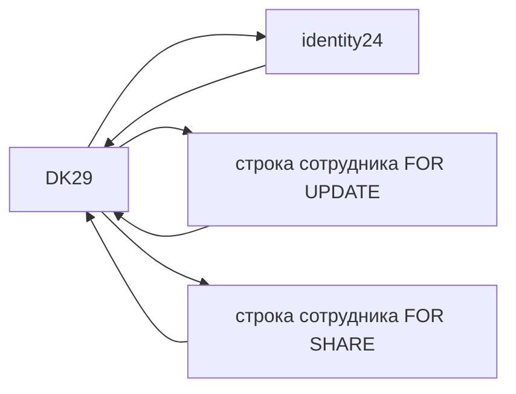
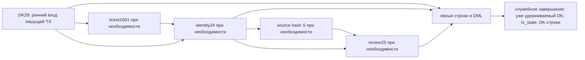

# Техресурс — шаг 41: проект единого порядка блокировок PostgreSQL

Дата: 19.10.2026. Проект C:/Projects/excel-ai-agent-8001.
БД/схема: ai_excel_agent_test/test_construction_identity_stage46.

**При текущих правах кандидата и произвольном SQL обязательный глобальный порядок DK → ticket → identity → строки обеспечить существующими DML-триггерами нельзя. Порядок пригоден как основа для контролируемых пишущих транзакций, но требует расширенного графа, изменения точек входа и модели полномочий либо принятия безопасных отказов. Готового доказанного серверного исправления нет. Никакой патч не внедрён.**

## Метод и полнота

Прочитаны app/API, repositories, services, database/миграции, оба изолированных прототипа и результаты шагов 39–40. Статический инвентарь содержит 150 строк с advisory/locking SELECT/LOCK TABLE, контекст функции, пути/строки и SHA256 соответствующих файлов. Это полный найденный перечень в обследованных исходниках, а не доказательство отсутствия неизвестного внешнего SQL или всех динамических путей. Динамические имена истории/отсутствий и вызовы помощников разобраны отдельно.

Выполнен новый READ ONLY каталог: **19 пользовательских триггеров, 57 FK, 10 функций**, все 19 триггеров enabled=O. До/после чтения количества и канонические отпечатки всех **41 таблицы** совпали. Новые конкурентные эксперименты, HTTP-записи и нагрузка не запускались; числа deadlock ниже относятся к шагу 40. Полные определения каталога сохранены без выгрузки персональных строк.

## Найденные ресурсы

В графах R означает ресурс/строку, стрелка — возможное последующее получение, скобки — условную ветвь. Повторное получение уже удерживаемого того же lock не является новым ребром инверсии. Порядок относится к одной транзакции, а не порядку HTTP-запросов пользователя.

| Обозначение | Ресурс и режим | Точки получения |
|---|---|---|
| D | Exclusive transaction advisory (20261017,29) | matrix_dk.reconcile/set_event; mark_matrix_dk_calendar_change на восьми источниках; snapshot/finish/touch прототипов |
| T | Exclusive transaction advisory (20261007,1601) | rail_tickets._ticket/confirm/set_object/annul/restore; production_assignments.save; production_matrix_overrides.upsert/remove |
| I | Exclusive transaction advisory (20261013,24) | construction_identity.prepare/check_catalog_name/reparent/legacy_move; ticket; assignments; report/facts; object_archive; identity API; четыре фактические функции guard/lock/validate identity/fact |
| V | Exclusive transaction advisory (20261015,25) | report_review.options/approve/cancel_rule/category через options |
| S(h) | Один bigint: первые 8 байт SHA256 файла, signed | daily_control_service.review_result(save=True), сериализация одного источника |
| A(k) | Один bigint: int первых 15 hex символов ключа попытки входа | user_auth.login, два ключа login/peer в sorted-порядке, затем FOR UPDATE auth_users |
| C | Exclusive transaction advisory (20261014,25) | clean_construction API/repository/миграции: отдельный clean-start профиль/БД, не текущая business-схема |
| R_U/R_S/R_K | Строки FOR UPDATE / FOR SHARE / FOR KEY SHARE | ticket, employee/history/crew/position, assignments, facts/overrides, справочники, aliases, auth; полный список в lock_sites.json |
| R_DML | Строковые блокировки UPDATE/DELETE, конфликты INSERT/UPSERT | Все пишущие таблицы; режим зависит от изменяемых ключей, индексов, FK. Не каждый UPDATE равен FOR UPDATE |
| L | Relation locks | SELECT/locking SELECT/DML получают табличные блокировки автоматически; явный LOCK TABLE — legacy move, миграции/cleanup |
| UQ/FK | UNIQUE/speculative insert и проверка родительских ключей | INSERT/UPSERT, изменения ключей и все FK; ожидание чужой транзакции возможно без явного FOR UPDATE |
| X | Закрытые строки dk_service.tx_state и signing_key | touch/register/snapshot/finish; finish берёт state FOR UPDATE; ключ читается только владельцем |

S и A используют одно bigint-пространство advisory, а пары D/T/I/V — другое; нельзя считать S/A различными пространствами только по смыслу хеша. При проектировании нескольких ключей в одной TX нужен стабильный порядок и анализ совпадений. Clean-start C — другая пара, хотя objid тоже 25; advisory-lock также локален БД. Это следует учитывать при диагностике по pg_locks ([официальное описание](https://www.postgresql.org/docs/18/view-pg-locks.html)).

Административные xact advisory, найденные в runner миграций (вне штатного runtime): (20260928,2), (20260929,3), (20260930,4), (20261001,5), (20261002,6/7/8/9), (20261003,10/11), (20261004,12), (20261005,13), (20261006,14), (20261007,16/17), (20261008,18/19/20), (20261012,21/22), (20261013,23/24), (20261014,25). Некоторые затем берут ACCESS EXCLUSIVE на таблицах; cleanup SQL также содержит LOCK TABLE. Нужны отдельное административное соединение и окно обслуживания, не смешивание с рабочими TX. Новые права приложению для них не предлагаются. В обследованном app найден только pg_advisory_xact_lock; новых session/try/shared вызовов app нет. Это не ограничивает доступность системных функций произвольному SQL.

## Графы найденных пишущих сценариев

Строковые/FK-ветви ниже сокращены по имени группы; полные FK перечислены в каталоге, конкретные locking SELECT — в статическом приложении. Обычные MVCC SELECT не считаются строковыми locking SELECT.

| Путь | Текущий граф одной TX | Совместимость с D → T → I → R |
|---|---|---|
| employees.create/update/archive/restore | D → R_employee → FK position/crew; завершение → R_DK | Ранний source DML имеет D, но не гарантирует отсутствие ранее взятых R/T/I |
| positions.create; внутренний positions.update | D → R_position; конец → R_DK | Условно соответствует с чистого входа |
| employees.rename_position | R_U(position) → D → UPDATE position | Инверсия R→D до statement-trigger |
| DELETE positions | D → R_position → FK UPDATE employees → D → R_employee | D повторный; нужны родительские/дочерние строки и доступные роли |
| crew_memberships | R_K(crew) → R_U(employees ORDER BY id) → D → UPDATE employees | Подтверждённый конфликт строки/D; сортировки ids недостаточно |
| crews.create/update | R_crew, без календарного DML | Не требует reconcile, но R_crew связан с employees через FK |
| DELETE crews | R_crew → FK SET NULL employees → D → R_employee | Поздний D при косвенном source DML; ранний D нужен до удаления родителя |
| luvr_history.create/upsert | R_K(employee) → D → R_history/UPSERT → FK | Уже R→D; KEY SHARE не конфликтует с любым UPDATE, но конфликтует с удалением/ключевым изменением |
| luvr_history.update | R_K(employee) → R_U(history) → D → UPDATE history | Инверсия, включая movement; _protect_ticket_movement дополнительно читает связь билета |
| luvr_history.delete_ticket_movement | R_K(employee) → R_U(ticket) → R_U(movement) → D → DELETE ticket/movement | Строки взяты раньше D; комментарий «ticket before movement» не обеспечивает глобальный порядок |
| employee_absences.save/delete | R_K(employee) → D → R_absence/sick → (labels UPSERT) | Поздний D; labels вне восьми источников, но FK к sick остаётся |
| rail_tickets.store_parsed_ticket | D → (R_insert/UNIQUE) → I row-trigger → FK employee/entity/object | Подтверждённый D→I; нет T перед INSERT, внутриоперационные UNIQUE/FK не исчезают |
| rail_tickets.confirm | T → I → R_U(ticket) → R_S(employee/дубликат movement) → R_U(movement) → D при записи → sync | Инверсии I/R→D; T/I повторные в помощниках |
| rail_tickets.set_ticket_object/reject | T → I → R_U(ticket) → D → UPDATE ticket → (sync) | Подтверждённый I→D; _view/identity helpers продлевают удержание |
| rail_tickets.annul/restore | T → I → R_U(ticket) → (R_U(movement)) → D → source DML → (sync) | Поздний D; ветви раннего возврата без DML не становятся писателями автоматически |
| rail_tickets.direction | T → I → R_U(ticket), без изменения направления | Блокирующее чтение, не календарная запись; запретить превращение этой TX в позднего source-писателя |
| import_employees | SELECT → первый D → повторные INSERT employees/positions → FK → финальное обслуживание | Одна пачка/один D до конца; нельзя разделять коммиты без решения об атомарности |
| matrix_dk.set_event/reconcile | D → (eligible, чтение membership) → R_DK/DELETE или INSERT+FK employee | Явный D раньше DK; смешивание с внешней TX/новой SEALED-фазой требует отдельного контракта |
| production_assignments.save | T → I → R_K(employee) → R_S(ticket,movement) → policy R_S(employee/production_control_mode_positions) → (R_S(source_assignment)) → R_DML changes/items → I trigger | Не пишет календарь сам; при вызове из ticket наследует уже взятые блокировки. Самостоятельно нельзя позже брать D |
| production_matrix_overrides.upsert/remove | T → R_S(ticket,movement,fact) → policy R_S(employee/production_control_mode_positions) → R_S(category/PO) → R_U(override) → DML; remove: T → R_U(override) | Не source-писатель; может ждать строки, которые держит иной I/D-писатель. Полного порядка T/I/R нет |
| identity assignments._save_identity | I → R_U(assignment при PATCH) → identity.prepare → DML/FK | Не source DML; FK/помощники дополняют граф |
| daily_control_service.review_result/save | I → (S(h) при save) → V → locking validation/assignments/subobject/PO → (replacement R_U fact/overrides) → INSERT fact/I trigger | Полный порядок требует S/V, а не только D/T/I; источники ДК не пишет |
| report_review.category | I → V → R_S(employee/category/PO) → R_U(assignment) → I → INSERT/UPDATE/event | Повторный I уже удерживается; без раннего I было бы R→I |
| report_review.approve/cancel_rule | V → R_DML(rules/approvals/events) | Самостоятельный домен, без D/I |
| matrix_report_service.delete_fact | I → R_U(fact) → R_U(overrides ORDER BY id) → DML архивирования/удаления | Не source, но пересечение с production overrides по R |
| objects/subobjects create/update; object_archive | I → R_objects/subobjects → (R_K parent) → identity/FK | Для штатного active-identity пути обычно I заранее; direct SQL предварительный R не контролируется |
| identity.reparent/legacy_move active | I → R_hierarchy/subobject и связанные DML/FK | Изменение структуры, само не source; нельзя потом брать D |
| subobjects legacy fallback move | R_U(subobject) → R_K(object) → L(daily_control_results SHARE ROW EXCLUSIVE) → DML | При активной identity штатный код выбирает адаптер legacy_move, не этот fallback. Не смешивать альтернативные конфигурации в «подтверждённый» цикл |
| PO/category справочники | (R_S(category)) → R_PO/category; DELETE/SET NULL/CASCADE дочерним | FK-замыкание важно, в том числе category→objects и PO/category→факты/назначения |
| value_aliases | create: R_S(target) → R_U(alias при совпадении) → INSERT; update: R_U(alias) → R_S(target) → UPDATE | Обратная последовательность alias/target требует анализа режимов: два SHARE сами совместимы; цикл с конфликтующим писателем не проверялся. Target может быть employees |
| luvr_month/form/add/remove | R_month/INSERT → (R_K employee) → R_membership/FK | Состав месяца не влияет на eligible, D не требуется; пересечение по родителю employee остаётся |
| clean_construction API/assignments | C → R_entity/alias/assignment/FK; update assignment → проверка available/C | Отдельная разрешённая clean-start БД/public. Не включать в текущий live-граф автоматически |
| user_auth.login | A(k1) → A(k2) в sorted порядке → R_U(auth_user) → sessions/events FK | Отдельное соединение, без D и без FOR UPDATE employee из JOIN. Не объединять с business TX |

### Подтверждённые циклы шага 40

Это сводный граф разных транзакций, а не последовательность одного запроса. В шаге 40 каждый тип дал по два 40P01 в legacy и new: всего 12. Четыре контроля без обратного запроса D завершились без deadlock. Числа 83/0 — успех тестовых ожиданий, не устранение конфликта. На шаге 41 новых воспроизведений нет.

Дополнительные циклы R_position/history/crew→D, родитель/FK→D, I→строки→I и разные порядки R_fact/R_override остаются **потенциальными**, хотя соответствующие рёбра видны в коде. Без проверки совместимости режимов и одновременной достижимости ветвей это не новые подтверждённые deadlock.

## Триггеры, FK и неявные блокировки

Фактическая active-схема:
- Восемь BEFORE STATEMENT matrix_dk_calendar_change: employees, positions, employee_movements, rail_tickets, employee_sick_periods, employee_luvr_day_overrides, employee_duration_exceptions, employee_absences. Они берут D независимо от значимости полей/числа строк.
- identity_structure_lock BEFORE STATEMENT INSERT/UPDATE на construction_objects/subobjects берёт I; register_identity AFTER INSERT создаёт entities/hierarchy.
- construction_hierarchy_guard BEFORE ROW берёт I; identity_reference_guard BEFORE ROW INSERT/UPDATE на employee_assignments, rail_tickets, production_assignment_items берёт I; fact_identity_guard на daily_control_results также берёт I.
- production_change_shape и production_items_shape — deferred constraint triggers. Текущее тело validate_production_assignment_shape читает state/count без явных locking SELECT и проверяет согласованность. Они не выполняют очистку ДК.
- validate_production_assignment_item с FOR SHARE subobject остаётся установленной функцией, но её прежний production_item_parent trigger отсутствует: активен identity_reference_guard. Наличие функции в pg_proc не означает действующий путь её вызова. Старые SQL-миграции и clean-start триггеры не выдаются за текущие.

Внутренние FK-триггеры не входят в число 19 пользовательских. Полные 57 FK и признаки deferrable сохранены в read_only.json. Их замыкание включает employee→position/crew, восемь источников/ДК/месячный состав/факты/назначения/auth→employee, ticket→movement/object/entity, production change→ticket, production item→change/object/subobject/entity/PO/category, overrides→item/fact/employee/PO/category, hierarchy/entities→старые объекты и другие справочники.

Особенно существенны ON DELETE SET NULL: employees.crew_id/position_id, rail_tickets.object_id, construction_objects.category_id, po_types.default_category_id, production_matrix_overrides.assignment_item_id. CASCADE есть для labels→sick и object_po→object. RESTRICT может остановить родительское удаление, но нельзя считать это доказательством отсутствия предварительно взятых блокировок на всех ветвях. В каталоге у employee_assignments найден FK entity_id; отсутствующие FK нельзя «добавлять» в граф по смыслу имён колонок.

FK-проверки дочерних ссылок, UNIQUE/UPSERT и DML могут ждать транзакции и родительские строки. Каскадные действия исполняют SQL на дочерней таблице и запускают её триггеры. Поэтому нужно закрывать вход до родительского DELETE, а не только на восьми таблицах. [Поведение PostgreSQL-триггеров](https://www.postgresql.org/docs/18/trigger-definition.html).

BEFORE STATEMENT не является хуком начала транзакции: он не перехватывает ранее выполненный SELECT FOR UPDATE/SHARE, другой DML, advisory вызов или LOCK TABLE. Автоматические relation locks получаются при выполнении команд; формула «D раньше всех блокировок вообще» неверна. Row-trigger тем более не доказывает I раньше всех блокировок строки/индекса. Для требуемого порядка I должен быть уже получен на входе контролируемого пути.

Обновление набора WHERE id=ANY(sorted_ids) не гарантирует порядок блокирования строк SQL-планом. Для контролируемой операции нужен отдельный детерминированный этап получения самых сильных требуемых строковых режимов, затем DML; необходимо учитывать новые FK/unique-ключи и повторную валидацию. FOR KEY SHARE совместим с некоторыми неключевыми UPDATE, но не с любым изменением; «любой FK всегда блокирует ФИО» не утверждается.

## Проверка предлагаемого порядка

Для контролируемого business-домена рекомендован частичный порядок:

S/V нужны отчётным цепочкам; их нельзя опускать из полного графа. A и C сохраняются отдельными доменами на отдельных соединениях/БД; объединение с business-TX требует нового анализа. Пропуск ненужной ступени допустим, возврат к более раннему ранее не удерживаемому ресурсу — нет. Повторное получение уже удерживаемого D/T/I допустимо.

**Порядок D → T → I → явные строки совместим с известными циклами только после изменения вызывающих путей. С текущими границами и grants он не обязателен и не является готовым полным порядком всех ресурсов PostgreSQL.**

Необходимо заранее зафиксировать порядок таблиц/ключей и режимов для каждой разрешённой операции; внутри таблицы — стабильные PK, для ДК employee_id/work_date, для составного месяца year/month. Все потенциальные строки и FK нельзя автоматически упорядочить одной сортировкой входного списка. При сложной операции общий D должен сериализовать весь замкнутый круг участвующих писателей до строковых блокировок, иначе нужны отдельные доказанные порядки для соседних доменов. Не предлагается автоматически выдавать D каждому GET/Excel.

Самостоятельные production_assignments/overrides и daily facts могут держать I/T/строки, не меняя календарь. Нельзя позволять им потом перейти к source DML в той же TX. Кроме того, возможны соседние циклы без обратного D: например, T→R_fact у overrides и I→R_fact/override у операций фактов. Их нужно проверить отдельно; один ранний D только у календарных писателей их не исключит. На первом строгом прототипе придётся определить замкнутый business-домен и либо сериализовать его общий вход, либо доказать совместимость независимых доменов.

## Где сервер может обеспечить порядок

| Место | Что реально можно обеспечить | Чего недостаточно |
|---|---|---|
| BEFORE STATEMENT на source | D до собственных source-row DML; учёт dirty/nonce, отказ SEALED | Не видит предыдущий SELECT FOR UPDATE/SHARE и получение I/T |
| BEFORE STATEMENT на родителях и связанных writes | Перехват FK-путей до родительских строк в новом контролируемом протоколе | Не заменяет контроль предварительных locking SELECT; требуется полный FK-охват |
| Узкая SECURITY DEFINER операция | D/T/I до внутренних SQL, закрытые данные/фаза, минимальный NOLOGIN-владелец | Внешний вызывающий уже мог взять строки; входные SQL-выражения вычисляются до тела функции |
| MatrixConnection / репозитории | Удобно брать D до _ticket, проверки crew/position/history; не делать подпись/очистку как границу безопасности вложенного SAVEPOINT | raw SQL и другие соединения этим не ограничены |
| Контролируемая новая пишущая TX | Получить D до business SQL, задать допустимый домен и запретить позднее повышение читателя в писателя | Признак «новое соединение» в Python не доказывает чистую TX для SQL-клиента с теми же полномочиями |
| Серверная точка входа с урезанными grants | Отсутствие прямого source/смежного UPDATE не позволяет кандидату предварительный locking SELECT этих таблиц | Нужно закрыть другие функции, advisory/LOCK TABLE, PUBLIC, смежные роли и аргументы, а не только две таблицы |

### Почему нельзя надёжно обнаружить «уже взяты несовместимые строки»

pg_locks не перечисляет все удерживаемые row locks: они обычно записаны в самих строках; ожидающий процесс виден через transactionid. Наличие/отсутствие tuple-строк не доказывает отсутствие удерживаемых FOR SHARE/FOR UPDATE, и вид не восстанавливает общий исторический порядок acquisition. [Документация pg_locks](https://www.postgresql.org/docs/18/view-pg-locks.html).

Поэтому отвергнут как недоказанный вариант «если в pg_locks нет tuple, можно блокирующе брать D». pg_blocking_pids показывает текущие зависимости, но не запрещает последующее образование цикла; опрос не является атомарным admission-протоколом. xmin/txid, GUC, dirty, nonce и наличие tx_state также не доказывают, что клиент ранее не взял другие блокировки. Создание чистой tx_state после грязного входа не исправляет порядок.

Можно исследовать pg_try_advisory_xact_lock(D) с немедленным отказом при busy: он не требует угадывать прошлые row locks и не добавляет ожидающего ребра на D. Но это **не реализация строгого раннего порядка**. Законная конкурентная операция тоже получит отказ; при SAVEPOINT клиент может оставить ранее взятые строки и повторять попытки. Блокирующие старые D-входы, функции и публичные системные advisory вызовы по-прежнему позволяют обход. Для целевой гарантии нужен аудит и закрытие всех таких входов, а также анализ I/T/строк/таблиц. Неблокирующие I/T либо NOWAIT на отдельных строках — отдельный режим с иной частотой отказов, пока не испытанный.

lock_timeout не делает deadlock невозможным: он ограничивает ожидание. В шаге 40 40P01 возник раньше 4-секундного lock_timeout. SERIALIZABLE также не является заменой глобальному порядку lock. Ограниченные таймауты остаются операционной защитой, не доказательством отсутствия циклов.

## Произвольный SQL и граница невозможности

При сохранении текущих полномочий кандидат может:
1. SELECT employee FOR UPDATE/SHARE, затем вызвать D-блокирующий source DML/служебный вход — атака уже подтверждена шагом 40.
2. Взять I/T системным pg_advisory_xact_lock перед D; DML-trigger не знает, что эту последовательность надо было начать раньше.
3. Имея UPDATE на таблице, явно брать сильные LOCK TABLE. Это дополнительный путь отношения L→D, не покрытый только проверками tuple. Права режимов LOCK TABLE описаны [PostgreSQL](https://www.postgresql.org/docs/18/sql-lock.html).
4. Блокировать две разрешённые строки в обратном порядке в разных TX. Даже устранение D/I-инверсии не означает полного отсутствия row-only deadlock у произвольного SQL.

Locking SELECT требует UPDATE хотя бы одного столбца таблицы — включая FOR SHARE/KEY SHARE. Поэтому точечный UPDATE(password_changed_at) также разрешает locking SELECT auth_users; снятие только DELETE не решает эту проблему. [Требования SELECT](https://www.postgresql.org/docs/18/sql-select.html).

**Неизменные grants + произвольный SQL + обязательное отсутствие указанных циклов несовместимы с текущими DML-триггерами.** Гарантия сохранности ДК после успешного COMMIT и гарантия отсутствия deadlock — разные требования: новый протокол может корректно откатить жертву, оставаясь подверженным отказам/DoS.

Варианты для решения:

| Вариант | Гарантия | Цена / границы | Рекомендация |
|---|---|---|---|
| Ранний D в Python, grants прежние | Устраняет известные штатные инверсии после перепроверки путей | Произвольный SQL обходит соглашение | Полезная совместимость, недостаточно для заявленной модели |
| Неблокирующие служебные входы и отказ при занятости | Может разрывать конкретные ожидающие рёбра | Нужна полнота входов, ограничение системных EXECUTE, изменения обработки ошибок; ряд циклов остаётся | Отдельный экспериментальный вариант, не готовый патч |
| Закрытый пишущий интерфейс + урезанные прямые grants + транзакционный admission | Можно проектировать обязательный порядок в замкнутом домене | Перенос DML в узкие операции, проверка всех путей/ролей/PUBLIC и границ TX | Рекомендуемая основа для строгого следующего прототипа |
| Доверенный отдельный исполнитель на новых TX | Клиент не исполняет произвольный SQL пишущей роли | Меняет модель угроз; требуется надёжный канал/идемпотентность/сохранение одной DB-TX | Альтернатива после явного принятия модели |

Закрытый интерфейс не должен быть универсальным execute_sql и не получает доверие только из-за названия SECURITY DEFINER. Необходимо отозвать прямые UPDATE/иные конфликтующие DML в замыкании затрагиваемых таблиц (сохраняя нужное чтение), исключить обход через столбцовые grants, функции, views, SET ROLE, PUBLIC и чужие роли-писатели. Вызовы блокирующих advisory функций доступны по системным ACL; PostgreSQL не даёт отдельный ACL на ключ D. Адресное ограничение EXECUTE требует проверки всех перегрузок и session/shared/try вариантов, зависимостей других ролей и PUBLIC. REVOKE только у кандидата не перекрывает PUBLIC. Это изменения полномочий, сейчас не разрешённые к применению.

Изолированный отдельный PostgreSQL упрощает контроль этих ACL, но сам не меняет порядок и не ограничивает произвольный SQL автоматически. Суперпользователь, владелец таблиц, утечка ключа/исполнение доверенного подписывающего Python остаются вне гарантии. Fixture-bypass по session_user прототипа нельзя переносить в рабочую модель без полного решения по всем писателям.

## Необходимые изменения для последующего прототипа — не выполнены

1. Зафиксировать threat model: произвольный SQL именно какой роли, список всех писателей, разрешённые HTTP-действия и необходимость прямого DML. Без согласования этой модели нельзя обещать обязательный порядок.
2. Для строгого варианта подготовить закрытые операции и ACL-план для всего business-замыкания, а не только employees/rail_tickets. Владельцы NOLOGIN, минимальные объектные права, полные имена/search_path, закрытый PUBLIC; кандидату по-прежнему не давать прямых UPDATE/DELETE production_matrix_dk. Auth и административные операции вынести в свои отдельные разрешённые соединения.
3. Определить серверное admission-состояние, которое не доверяет GUC и не выдаётся поздно поверх уже заблокированных строк. Сама метка «D acquired» в закрытом журнале не доказывает порядок до её выдачи; доказательство опирается на закрытые возможности получить предыдущие конфликтующие lock. Если такой ACL-контур неприемлем — принять меньшую гарантию либо менять интерфейс исполнения SQL.
4. Для контролируемых операций получать D в верхней пишущей TX до _ticket/T/I, crew/position/history FOR UPDATE и employee FOR SHARE/KEY SHARE. Это затрагивает employee/position/history/absence/crew, все пишущие ветви билетов, массовый импорт и косвенные FK-пути. Сохранить атомарные пакеты, не нарезать их на COMMIT для обхода lock.
5. Не допускать, чтобы вызываемые с connection=conn production_assignments.save/sync сами объявляли новую внешнюю TX или нарушали уже выбранный домен. Для самостоятельных назначений/overrides/фактов решить общий граф с T/I/S/V/строками; запретить поздний переход к source DML. Предварительные чтения UI выполнять вне пишущей TX, затем повторно валидировать значения/версии после раннего lock.
6. Ручные ДК имеют отдельную бизнес-авторизацию. Сохранить её; включить разрешённого ручного писателя в сериализацию D и запрет изменений состава ДК после SEALED. Никаких новых HTTP-разрешений обеим ролям ради совместимости не выдавать.
7. Служебные touch/snapshot/register/finish должны работать в едином контракте владения D и закрытого состояния; прежний prune не оставлять обходным входом. Сохранить единственный eligible(), HMAC с полным контекстом, nonce, PID/TX и неизменённую финальную серверную проверку. Порядок блокировок не повод сокращать отпечаток.
8. Отдельно спроектировать обслуживание tx_state: retention не должен брать X-строки, а потом ждать D в обратном порядке. Миграции, cleanup и ручные FK-операции требуют окна/контракта с писателями, а не исключений по произвольной роли.

## SAVEPOINT, deferred cleanup и SEALED

D должен быть transaction-level, получен в контролируемой внешней TX до первого конфликтующего действия, а не в autocommit-команде с немедленным освобождением. При нормальном SAVEPOINT внутри уже допущенной TX D остаётся у внешней транзакции; ROLLBACK TO до его получения может освободить полученные после точки блокировки. Поэтому нельзя хранить признак admission вне транзакционной семантики либо считать один txid вечным доказательством входа. Для общего правила освобождения после savepoint см. [Explicit Locking](https://www.postgresql.org/docs/18/explicit-locking.html).

Закрытое состояние/nonce/намерение и источник/ДК откатываются согласованно. После ROLLBACK TO точки до начала новой фазы нельзя использовать токен старой ветви или присвоить новую ревизию с прежним доказательством. RELEASE SAVEPOINT не означает окончательное завершение. Python transaction() вложенного уровня не должен преждевременно удалять ДК.

Внешний COMMIT требует актуального подписанного намерения и серверной проверки полного контекста; ошибка откатывает источники и ДК вместе. SET CONSTRAINTS ALL/имя IMMEDIATE может вызвать finish раньше, поэтому после фактического применения SEALED блокирует изменения источников/состава ДК независимо от дальнейшего SQL. DEFERRED не снимает SEALED. Снятие SEALED допустимо только как результат отката самой фазы, с восстановлением данных и допустимого admission. Поведение раннего исполнения следует из [SET CONSTRAINTS](https://www.postgresql.org/docs/18/sql-set-constraints.html).

Если finish повторно получает D, уже удерживаемый внешней TX, это не поздний новый захват. Если D фактически отсутствует, доверять dirty/GUC или прежней отметке нельзя: нужен проверенный отказ/контракт нового входа. Точное доказательство этой проверки — задача прототипа, не готовый SQL в отчёте.

Особенно проверить BEGIN → SAVEPOINT → попытка позднего D → ошибка → ROLLBACK TO: ранее удерживаемые строки могут остаться. Откат только неудачной попытки не превращает TX в чистую. Нельзя лечить инверсию внутренним SAVEPOINT и продолжением со старым списком строк/подписью.

## Влияние на штатные операции

Календарные правила eligible(), расчёты ЛУВР/матрицы/ВОУ не требуют изменений. Меняются точки захвата lock, границы входа в пишущую TX и, для строгого решения, полномочия. Нельзя объявлять такие изменения незаметной перестановкой двух SQL-команд.

Ранний D увеличивает время его удержания за счёт _view, проверок, nested sync и возможного I/T-ожидания. Это может усилить очередь, выявленную шагом 38. PDF-разбор/чтение файлов, пользовательское подтверждение и тяжёлую внешнюю работу желательно держать вне пишущей TX, затем валидировать неизменность нужных входов внутри; это предложение к отдельной реализации, не разрешение разорвать атомарность источников и ДК. ВОУ/файлы PostgreSQL сам не откатывает.

Читающим проекциям ЛУВР/матрицы/ВОУ в READ ONLY не нужен D для самого расчёта; они всё же разделяют CPU/диск и relation locks. Блокирующие «чтения» FOR SHARE/UPDATE нельзя приравнивать к обычным MVCC GET. Закрытый интерфейс потребует адаптации фикстур/админских инструментов и provision-auth соединения, а не расширения runtime grants.

Неблокирующий вариант будет отдавать больше отказов при нормальной конкуренции. Повтор операции после 40P01/55P03 и неопределённого COMMIT требует отдельного договора об идемпотентности, файлах и сообщении UI. Слепой retry не проектировался. Число пользователей, Cnormal/Cpeak и SLA по-прежнему не установлены шагом 39; новый порядок нельзя объявить удовлетворяющим нагрузочным ориентирам без измерений.

## План следующего изолированного доказательства

Перед реализацией требуется выбрать модель из таблицы вариантов. Критерий строгого варианта: не только отсутствие наблюдённых deadlock в удачных запусках, но и невозможность недоверенному кандидату построить обратные рёбра в заявленном домене.

| Группа | Управляемая проверка | Требуемое наблюдение |
|---|---|---|
| Контроли шага 40 | Сохранить старые 12 deadlock как отдельный положительный контроль; новые ticket upload/object, employee/crew, FOR SHARE/write расписания | В новом протоколе нет тех же циклов; конфликтующий недопустимый вход получает явный отказ, без частичных данных |
| Полные бизнес-цепочки | Настоящие repo/HTTP upload и object change, confirm/annul/restore только как изолированные административные/внутренние сценарии, nested sync | Не расширять HTTP-права, трассировать все T/I/D/строки, не выдавать минимальные SQL-тесты за полный путь |
| Расширенный граф | Position/history/absence, FK crews/positions/object/category, assignments/overrides/facts, aliases, ручной DK, UNIQUE-дубли | Проверить совместимость режимов, порядок таблиц/ключей, несколько строк/обратные входные списки, каскады |
| Произвольный SQL | Предварительные FOR UPDATE/SHARE/KEY SHARE, LOCK TABLE, старый prune, системные advisory session/xact/shared/try перегрузки, функции/VIEW/SET ROLE | Native ACL либо доказанный безопасный отказ; отсутствию tuple в pg_locks не доверять |
| Аргументы/составные команды | Вход с подзапросом/функцией в аргументе, CTE с DML, multi-statement, предварительный I/T и session lock предыдущей TX | Нельзя получить поздний «чистый admission» после скрытого захвата ресурса |
| SAVEPOINT | До/после admission, intent, finish; rollback до/после удаления, повторные FULL/TRAVEL/HALF, RELEASE | D/state/nonce/данные согласованы; устаревшая подпись не используется |
| Завершение | Raw COMMIT без intent, IMMEDIATE/DEFERRED по имени/ALL, dirty=0, подмена GUC, ранний finish | Отказ либо корректная очистка и SEALED, без потери пригодного ДК |
| Другие писатели | Все runtime/служебные роли, ручные ДК, retention, административный режим | Нет fixture-bypass, неучтённой роли или обратного порядка вне допущенного домена |
| Ошибки/сохранность | lock_timeout/statement_timeout, 40P01, исключение в середине операции, отмена/обрыв | Откат всех DB-эффектов, повторный вход работает; сравнить исходный eligible/матрицу/ЛУВР/prepare_data |

Использовать отдельный временный PostgreSQL, управляемые barrier/pg_locks, ограниченные таймауты/число повторов, журналы SQLSTATE и COMMIT/ROLLBACK. Сравнить 41 рабочую таблицу READ ONLY до/после; удалить кластер/роли/ключи/процессы. Нагрузку измерять только после отрицательных проверок, отдельно от доказательства порядка. На шаге 41 этот план не запускался.

## Артефакты, сохранность и решение

Создан настоящий отчёт и каталог:
backend/output/security/auth_step41_audit_20261019T114721Z/
- read_only.json — актуальные определения 19 триггеров, всех 57 FK и 10 функций; 41 отпечаток до/после, fingerprints_unchanged=true;
- lock_sites.json — 150 найденных статических мест с файлами/строками/функциями и SHA256; включает действующий runtime, исторические миграции и отдельные прототипы с явными границами применения.

Выполнены только чтение исходников, READ ONLY запросы и подготовка документа/диагностических файлов. Новых тестов — **0**; шаг 40 остаётся 83 успешных метода с 12 ожидаемыми 40P01, а не новым результатом шага 41. Рабочая схема, grants/роли/триггеры, производственный код и протоколы не менялись; сервер 8001 не перезапускался. Реальные аккаунты не создавались; 8000/Tunnel не запускались. Историческое расхождение construction_objects не исправлялось.

**Рекомендация: согласовать закрытый пишущий интерфейс и модель admission/полномочий, затем отдельно испытать его. При сохранении прежнего произвольного SQL и прямых UPDATE строгий обязательный порядок не обеспечен. К реализации изолированного архитектурного кандидата после согласования — готовность есть; к рабочему внедрению — нет. Автоматического перехода к следующему этапу нет.**
