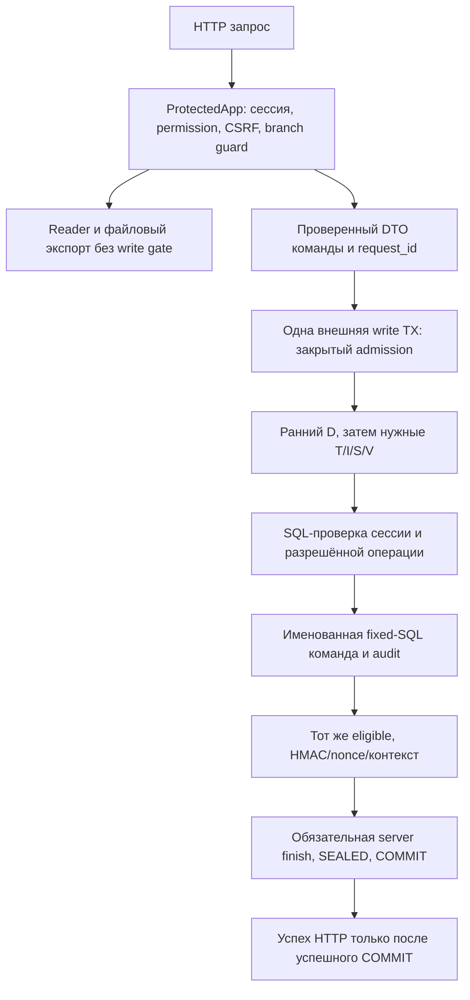

# Техресурс — шаг 43: проект полного защищённого контура записи

Дата: 19.10.2026. Проект C:/Projects/excel-ai-agent-8001.
БД/схема: ai_excel_agent_test/test_construction_identity_stage46.

**Подготовлен архитектурный проект и реестры. Защищённая запись всего приложения ещё не реализована. Результат шага 42 — четыре экспериментальные SQL-операции и 103 успешных теста — не распространяется автоматически на полный контур, авторизацию SQL, кадровую историю или всех писателей. Рабочие изменения и новые испытания на шаге 43 не выполнялись.**

## Комплект и фактическая база

- [Реестр HTTP](auth-step43-write-registry-2026-10-19.md): все 97 методов вне GET/HEAD/OPTIONS/MOUNT из 163 route policies плюс 3 дополнительных GET-экспорта, всего 100 строк. В каждой строке — handler, роль/guard, таблицы/эффекты, проверки, TX/locks/ДК, проект SQL-прав и закрытого входа.
- [Внутренние писатели](auth-step43-internal-writers-2026-10-19.md): 96 групп функций, служебные задачи/импорт/администрирование. Статический инвентарь — 655 SQL/DDL/locking мест и 86 динамических/косвенных вызовов, не выданных за доказанные записи.
- [Отдельный кадровый проект](auth-step43-personnel-design-2026-10-19.md): датированные переводы, сохранение crew/category, И.О. и отдельная строка Руководителя СК без двойного времени.

Реестры построены по исходникам и явным политикам, не по названию HTTP-метода: POST /check, review-options без approval, upload/разбор и Excel могут не писать PostgreSQL. Conversely внутренний PATCH разрешённого назначения может технически удалить заменённые items; это не равно разрешению пользовательского DELETE. Ни одна существующая DENY-ветвь не стала разрешённой от включения в реестр.

READ ONLY срез рабочей БД: 41 таблица, 17 PostgreSQL-ролей, **единственная LOGIN-роль postgres (SUPERUSER)**. Эффективные INSERT/UPDATE/DELETE/TRUNCATE таблиц имеют postgres и встроенная NOLOGIN pg_write_all_data; членов pg_write_all_data не обнаружено. Последняя — потенциальное системное полномочие, не обнаруженный используемый сервис. В момент среза других соединений к этой БД не наблюдалось; это не журнал активности и не доказательство отсутствия внешних клиентов. Новых рабочих runtime-ролей нет, auth_users=0.

Прикладные permissions в БД: SYSTEM_TECHNICIAN = data.read/data.create/data.update/excel.export; OFFICE_MANAGER = data.read/excel.export. Действующий 8001 ещё не включил обязательную защиту, поэтому эти политики описывают подготовленный защищённый режим, а не фактическую авторизацию всех текущих запросов.

## Реализовано, экспериментально и будущее

| Слой | Действительное состояние |
|---|---|
| Текущие repos/HTTP, восемь source-триггеров, MatrixConnection/reconcile | Существующий код. Рабочее подключение суперпользователя не заменено |
| ProtectedApp, AuthService, route policies, защищённый launcher | Подготовлены/испытаны ранее, не включены текущим сервером обязательным режимом |
| Signed intent + HMAC + nonce + deferred finish + SEALED | Только временные прототипы шагов 33/37; известные старые атаки воспроизводятся в отдельном старом контроле |
| closed_write.employee/crew/ticket/ticket_object | Только шаг 42: отдельная роль, 15 readable relations, без прямого DML/advisory, шесть управляемых пар; не полные репозитории |
| write_api, полный admission/SQL user authorization, все владельцы/ключевая ротация/retention | Проект этого отчёта, не созданы |
| История должностей, переводы, замещения и распределение И.О. | Будущие требования пользователя, не реализованы и не испытаны |

## Матрица прикладных полномочий

E = SYSTEM_TECHNICIAN; O = OFFICE_MANAGER. Наличие внутреннего административного кода не вводит третью прикладную роль и не меняет E/O.

| Группа | E | O | Что сохраняется/ограничивается |
|---|---|---|---|
| Просмотры/журналы/матрица/ЛУВР/архив | Да | Да | Только data.read, нужные данные, без вызова write-gateway |
| Excel/export, включая POST month/export | Да | Да | excel.export + READ ONLY SQL; FS-артефакт не business-DML |
| Создание/правка сотрудника, должности, экипажа-справочника | Согласованные create/update | Нет | Поля/валидация текущих форм; архив/restore/delete DENY |
| Истории движений/болезней/исключений/дневных overrides и отсутствия | Согласованные create/update | Нет | Удаление DENY; связанный подтверждённый билет не редактировать через обход истории |
| Билетный upload | Да, один файл/операцию | Нет | Сохранить single_ticket_file; не превращать в bulk по имени SQL-входа |
| Объект билета | Да | Нет | Identity/источник/version, nested assignment semantics сохранить |
| Подтверждение, reject, annul, restore, ручное direction билета | Нет | Нет | Текущий DENY, даже если старый repo умеет выполнять |
| Формирование ЛУВР/добавление состава | Да | Нет | Удаление состава и settings DENY |
| Производственные/static назначения и matrix overrides | Согласованные create/update | Нет | Revision/version и source; logical delete/произвольная замена факта не разрешаются |
| Новые daily facts/check/upload/options без approval | Да по guards | Нет | daily_no_replace/review_no_approval; не открывать Office POST только потому, что ветвь читает |
| Ручные ДК | Нет | Нет | Старое server LEADER не становится новым правом E/O; автоматика ДК отдельно |
| Объекты/подобъекты, категории/ПО/aliases | Согласованные create/update | Нет | DELETE/archive/reparent/move/admin settings DENY согласно каждой route policy |
| ВОУ generate+UUID archive | Да по текущей policy | Нет | Office читает/скачивает/экспортирует разрешённые результаты, но не получает новую generate-команду |
| Настройки, approval/rules, замена/удаление facts, clean-start, process-folder/bulk | Нет | Нет | Все текущие DENY сохраняются |
| Login/logout своей сессии | По общему auth-процессу | По общему auth-процессу | Технические session/event-записи не являются правом Office менять бизнес-данные |
| Аккаунты/пароли/роли PostgreSQL/миграции/repair | Нет | Нет | Отдельное административное разрешение и инструменты, не runtime |
| Перевод/отдельная смена crew/category/замещение | Только будущие согласованные кадровые команды E | Только просмотр/экспорт | Сейчас их нет; текущий bulk crew-memberships остаётся DENY, ретроисправления/подтверждения автоматически не добавляются |

## PostgreSQL-роли и доверенные границы — предложение

Все перечисленные имена условные; рабочие роли не создавались.

| Роль/компонент | Целевые права | Запреты и доверие |
|---|---|---|
| runtime_read | SELECT согласованных business views/relations, только RO транзакции | Без direct DML, write EXECUTE, ключей/tx_state/auth credential-таблиц, CREATE/TEMP/владения/членства |
| runtime_write | EXECUTE только разрешённых именованных write_api-команд + нужное чтение | Без table/column DML, sequence прав, raw locking/advisory, admin или generic SQL |
| auth_runtime | Отдельное доверенное соединение auth-компонента; нужное чтение password verifier/session/roles и узкие login/logout/revoke service-входы | Не business DML/DDL, не DK key. Компрометация auth-runtime опасна для сессий; не приравнивать её к испытанному SQL-кандидату |
| business owners NOLOGIN | Нужные INSERT/UPDATE столбцов, refs/identity/sequence, строго ограниченные внутренние DELETE по согласованному PATCH | Не выдавать приложению членство. Разделить owners people/tickets, directories, facts/assignments; пересмотреть стоимость FOR SHARE прав |
| dk_owner NOLOGIN | Чтение полного контекста, UPDATE одного DK-столбца для row lock, DELETE DK, ключ/состояние/finish | Не бизнес-управление пользователями; app не получает его DELETE или ключ |
| import operator / import owner | Только разрешённый closed import пакет через общий gate | Не direct bulk SUPERUSER в runtime. Нынешний CLI не становится пользовательским API |
| auth-admin/provision | Создание/блокирование/смена credentials/роль приложения по отдельному разрешению | Недоступен business runtime, Office/E; отдельные секреты и аудит |
| maintenance / migration / recovery | Отдельное административное соединение, backup/restore/DDL/ACL по утверждённому сценарию | Не launcher и не app env; режим обслуживания, не fixture-bypass |
| test fixture / temp admin | Только свои временные кластеры | Не существует как рабочее исключение из обязательных source-триггеров |

Одна SQL-роль на процесс не различает пользователей E/O сама. Режимы read/write выбирает доверенный сервер по проверенной сессии; клиент не выбирает DSN/role/тип соединения. OFFICE-запросу нельзя выдавать write-соединение только по POST или заголовку x-role.

FOR SHARE/KEY SHARE тоже требует UPDATE хотя бы одного столбца. Поэтому сохранение таких locks у нового NOLOGIN-owner требует явного минимального column-grant либо отдельного доказанного изменения locking-протокола. Нельзя механически копировать app_role_grants.json или добавлять UPDATE приложению ради прохождения запросов. Техническое удаление production_assignment_items в разрешённом PATCH должно быть ограничено проверенным change_id/retained_ids, version и correction_history; никаких универсальных delete(table,id).

## Две независимые гарантии

1. **Авторизация команды:** пользователь действующей сессии вправе выполнять именно эту операцию/ветвь над этими данными.
2. **Целостность ДК:** подписанный доверенным eligible результат актуален для окончательного сериализованного состояния; сервер не допускает stale COMMIT и изменений после SEALED.

HMAC-ДК не доказывает п.1. Проверенный SHA/HMAC или «backend вызвал» не заменяет user authorization. actor_id, permission=true, выбранная пользователем роль, GUC или имя функции сами не подтверждают полномочия.

## Архитектура вызова

Порядок предполагает, что чистое предварительное чтение не берёт опасные locks. После ожидания D полномочия надо перепроверить: очередь могла пережить срок/отзыв сессии. SQL-вход получает **секрет действующей сессии**, не caller-supplied user_id/roles; закрытый auth-check вычисляет тот же digest и читает active session/user/roles/permissions, учитывает is_blocked/архив сотрудника/credential_version/expiry. У бизнес-ролей не должно быть SELECT auth_users password_hash/auth_sessions token_hash и возможности mint/revoke чужой session.

Текущий AuthService.digest — SHA256 токена; предложенный SQL-check должен сравнивать SHA256 исходного секрета, а не принимать сохранённый token_hash как bearer. Это проект, не готовая реализация. Все параметры сессии/ключа передавать в памяти/parameterized SQL, не в GUC, URL, CLI, SQL literal или обычный лог. Закрытый checker не возвращает verifiers/внутренние причины отказа клиенту. Изменение логирования параметров на будущем отдельном экземпляре требует отдельного согласования.

SQL owner сам определяет actor из session и пишет audit(operation,actor,request_id,target,version,outcome) без паролей/токенов. Поле operation фиксируется именем закрытой функции и её whitelist, а не свободной строкой «разрешаю всё». Актор и действие входят в будущую связку transaction authorization/intent; успешный HMAC чужого контекста не должен авторизовать иную команду.

Политика отзыва во время уже начавшейся TX требует решения о точке авторизации. Рекомендуется проверка после ожидания gate и перед завершением, отказ при уже видимом отзыве/истечении. Это ещё не доказательство строгого мгновенного отзыва между последним check и COMMIT. Дополнительные auth row-locks нельзя добавлять без графа logout/revoke/provision; стандарт «момент проверки» против «отмена in-flight TX» согласовать и испытать.

Argon2-проверка пароля остаётся единственной существующей в доверенном auth-компоненте. Нельзя закрыть login SQL-функцией, принимающей от атакующего SQL-флаг password_valid=true. Для adversarial-модели самой auth SQL-роли потребуется независимое защищённое доказательство проверки либо доверенный изолированный исполнитель. Шаги 37/42 это не доказывают. До отдельного решения auth_runtime — явная доверенная граница, не скрытый эквивалент недоверенной runtime_write.

## Карта транзакций и обязательный порядок

Обозначения D/T/I/S/V/A соответствуют шагу 41. Предлагаемый первый полный прототип консервативен: **все business-writers общего замкнутого домена входят через D**, даже когда сама команда не требует reconcile. Это цена доказуемого первого расширения, а не утверждение, что всем операциям по бизнес-смыслу нужен ДК.

| Контур | Предлагаемый порядок / граница | Обслуживание ДК |
|---|---|---|
| Сотрудники/должности/crew membership, истории, отсутствие, любые ticket source-переходы | Одна внешняя TX; D → T/I по полному plan → нужные строки/FK → obligation/intent → finish | Обязательно при изменениях источников, в том числе незначимых для конкретного ДК |
| Объекты/identity/справочники/aliases, назначения/overrides/facts | D как общий gate пересекающихся business-writers → T/I → source hashes S sorted → V → строки | Сам D не создаёт obligation. Если восемь источников не менялись — не нужен HMAC-reconcile только ради gate |
| Формирование ЛУВР/состав | Общий gate до month/employee locks; snapshot/вставки одной TX | Состав не условие eligible; не создавать искусственную очистку, пока источники не изменены |
| Ручной ДК | Только отдельно разрешённый служебный/админский сценарий с D и явной user authorization | Не выдавать двум app-ролям. Изменение DK-состава до/после intent/SEALED обязано учитываться |
| Login/logout/revoke | Собственное auth-соединение, A sorted → auth rows; source только обычное чтение | Может быть независимым только при запрете перехода к business DML/D в этой TX и доказанном auth/FK-графе |
| Обычные просмотры, pure calculate, Excel/ВОУ RO preparation | READ ONLY/MVCC snapshot, без write-admission | Независимы от D; сохраняют relation locks/нагрузку CPU/диска |
| Upload/check/options без approval | Разбор/чтение/свой V, без последующего повышения того же соединения в business-writer | Не source-DML. Save — отдельная заранее объявленная write-TX с повторной валидацией |
| ВОУ/файловая публикация | Подготовка из согласованного RO snapshot, COM/FS вне удержания business D | Нельзя считать FS атомарным с PostgreSQL |
| Настройки, auth provisioning, retention, migration/repair | Отдельные узкие владельцы и свои протоколы; admin не получает путь R→D | Независимость условная, не вывод из имени таблицы. Shared refs/DDL требуют окна либо общего gate |

Для фактической полноты недостаточно повторять enter() в начале каждой функции. Если клиент сначала выполнил employee(), получил строки, а затем в той же TX вызывает daily.save и впервые запрашивает S/V, возникает позднее расширение домена. В полном admission нужно **заранее объявить типизированный plan**: допустимые команды, проверенные payload/их канонические digest, все нужные lock domains/keys и actor/request_id. Сервер выводит план из fixed whitelist, получает весь нужный префикс до строк и хранит его в закрытом транзакционном состоянии. Позднее добавление отсутствующего домена/команды отвергается; если нужен атомарный смешанный workflow, он должен быть заранее объявлен, а не молча разбит на COMMIT.

Это не универсальная функция исполнения SQL: plan не принимает SQL, имена таблиц, выражения, динамические поля или новые action names; именованные команды проверяют принадлежность plan и применяют только собственный fixed SQL. Чистая standalone-команда может создавать свой минимальный plan. GUC, отсутствие tuple в pg_locks и caller-supplied «clean transaction» по-прежнему не доказательство входа.

S и A сейчас делят bigint-пространство. Перед строгим разделением auth/business нужно согласовать **непересекающиеся namespaces** и стабильное сортирование ключей; одного хеш-префикса по смыслу недостаточно. Нельзя менять lock-key mapping по частям при одновременно работающих старых писателях. Возвращение к I/T/D после любых поздних строковых/FK-lock запрещено, кроме повторного получения уже удерживаемого lock. Новые NOLOGIN owners, S/V/auth-ветви и FK должны пройти новые управляемые расписания, а не объявляться доказанными шагом 42.

Прямые runtime locking SELECT и все опасные advisory/LOCK TABLE/CREATE/TEMP-пути закрываются эффективными ACL, включая PUBLIC/столбцы/views/функции/членства. Из 21 перегрузки advisory каждая разрешается только владельцу, которому она необходима; auth-owner нужен соответствующий auth-вариант, бизнес/ДК-owner — точечные варианты, SQL-кандидату ни один. В общей рабочей БД это требует отдельного разрешения/анализа зависимостей. Никакого REVOKE здесь не было.

## HMAC: жизненный цикл ключа и намерения

### Создание и хранение

- Рабочий DK-ключ ещё не создан. Будущий 256-битный случайный ключ генерировать доверенным provisioning-компонентом, не SQL-кандидатом. Назначить key_id, purpose=DK, версию протокола, instance/database/schema identity и статус.
- SQL-копия — закрытый keyring dk_owner, без SELECT у runtime/reader/auth; Python-копия — только в памяти доверенного подписывающего процесса. Отдельный DPAPI blob/учётная запись запуска и FS ACL — возможная схема, но secure_pg_secret шага 32 подготовлен для PG-пароля и не интегрирован как готовое DK-хранилище.
- Не использовать .env/CLI/GUC/обычный лог/API для ключа. Не объединять ключ с паролем PostgreSQL или session token. SQL дампы ключевого хранилища и Windows-профиль/DPAPI backup требуют защищённого отдельного восстановления; одного ciphertext недостаточно.
- Подписывающий код/версия loader и зависимости фиксируются доверенным deployment. Компрометация процесса/ОС/ключа вне гарантии SQL-кандидата; HMAC сам не пересчитает календарь в БД.

### Формирование и COMMIT

1. Контролируемый plan получает ранние locks; private source-триггеры независимо от raw COMMIT создают obligation и новый nonce/revision при каждом source DML. dirty остаётся только подсказкой.
2. После последних изменений один канонический eligible() читает согласованные доверенные источники. В новой версии подпись должна связать purpose/key_id/protocol+dependency version, instance/DB/schema, top-level TX/PID, private nonce/revision, plan/actor-operation binding, полный контекст и канонический список. Это расширение проекта, не описание уже существующего dk37 payload.
3. Регистрация проверяет подпись и сохраняет намерение без удаления. Нельзя подписывать caller-provided is_invalid/list без вычисления, принимать непроверенную роль или доверять search_path клиента.
4. Серверная обязательная finish повторно проверяет актуальность и допустимый ключ/версию/plan, атомарно применяет список и SEALED. Все source/состав DK-пути после применения отклоняются. Повторные deferred события не повторяют удаление.
5. SET CONSTRAINTS IMMEDIATE может применить раньше COMMIT; он не отменяет SEALED. SAVEPOINT до применения возвращает данные/состояние/locks по семантике подтранзакции; старое доказательство откатанной ветви не оживает. RELEASE не заменяет внешнюю finish.

Прототип вычисляет полный отпечаток девяти таблиц; его стоимость шага 38 известна, но сокращение контекста этим проектом не разрешается. Новые кадровые зависимости требуют новой версии протокола/obligation/контекста и отрицательных тестов; текущая девятка не покрывает history/acting автоматически.

### Ротация и авария

Ротация — отдельная versioned операция: создать новый key_id, безопасно передать обе копии, проверить соответствие без удаления, согласованно включить подпись/верификацию. Зафиксировать, какой key_id допускается для уже начатой TX; старый держать только до окончания допустимых in-flight транзакций/окна, затем отозвать. Новый/старый код нельзя смешивать без совместимого version check. При утечке — fail-closed/отзыв и диагностика без секрета, не fallback на прямой DELETE или суперпользователя.

Отсутствующий/несовпадающий ключ, несовместимая версия или stale intent — отказ и откат общей TX. Автоматически переподписывать чужой список/пропускать cleanup запрещается. Пароль роли и HMAC имеют независимые ротации; оба изменения требуют rollback-плана и отдельного разрешения при рабочем применении.

## tx_state, idempotency и восстановление

Предлагаемая private state-машина: **admitted → dirty/unprepared → intent_registered → sealed → committed-visible**; rollback соответствующей ветви отменяет её состояние и data-effects. committed-visible — логическое состояние, не существующий в прототипе callback после COMMIT. Нужны request_id, protocol/key id, plan/actor binding, nonce, флаги obligation, timestamps/versions и защищённые результаты. Runtime не редактирует это напрямую.

Строки нынешнего tx_state остаются после COMMIT и не имеют production-retention. Будущий GC — отдельная ограниченная maintenance-функция, удаляющая только доказанно завершённые видимые состояния после согласованного audit/retry/key окна, ограниченными порциями. Не удалять «всё по возрасту xid», активные или откатываемые состояния и не принимать внешний список произвольных xid. Sealed-at не равен точному committed-at; критерий retention и доказательство отсутствия активной/подготовленной TX требуют отдельного проекта. GC не должен брать state rows и затем ждать D в обратном порядке. 2PC/prepared transactions пока не поддерживать без отдельного доказательства/предварительной проверки конфигурации.

Для повторов нужен закрытый request ledger в той же бизнес-TX: operation + actor + канонический payload digest + request_id + committed result. Тот же request_id с другим действием/данными отклоняется. На сетевой неопределённости сначала запрос исхода, а не повтор entire upload/import. Существующая dedup по digest/page/unique facts сохраняется и не заменяется одним request_id. Журнал пользователя не заменяет закрытые state/proof-данные.

40P01/55P03/57014, ошибка проверки, stale authorization, отсутствие ключа: бизнес-эффекты откатываются вместе. Можно заново начать всю разрешённую DB-команду после rollback только по согласованной политике повторов, без скрытого успеха UI. Внутренний SAVEPOINT после уже удерживаемых опасных строк не лечит поздний admission.

Файлы PostgreSQL не откатывает. ВОУ сейчас публикует UUID-каталог через staging/rename; это не distributed transaction с БД. Сохранить staging/проверки, публиковать только после известного DB/read snapshot исхода; при будущих job/audit DB-записях определить recoverable publication/outbox и сверку статуса. Это проект, outbox-таблица не создана. Удаление/переиздание архива не выдаётся E/O.

## Кадровый функционал и согласование семантики

Отдельный [кадровый проект](auth-step43-personnel-design-2026-10-19.md) содержит модели интервалов и версий, transfer/change_crew/change_category/acting-команды, историческое чтение и обязательные проверки. Основные неизменяемые требования:
- перевод действует с установленной даты, сохраняет историю и **не меняет категорию/crew**;
- crew/category меняются самостоятельной командой Системотехника, Office только читает/экспортирует;
- основная должность при И.О. сохраняется, период И.О. отдельный;
- И.О. Руководителя СК остаётся отдельной строкой ЛУВР, но время сотрудника не удваивается;
- отчёт за дату использует должность/согласованную версию её реквизитов на эту дату, архив не переписывается;
- новая history/acting-зависимость требует версии HMAC/контекста/loader/триггеров, а не молчаливого обхода нынешних девяти таблиц.

Имеющегося position_id недостаточно для достоверного исторического backfill. Смысл личной категории, доли/пересечения И.О., ретроисправления и влияние замещения на пригодность ДК пока не определены. Примеры кадрового проекта не являются новыми утверждёнными правилами расчёта или правами текущего API.

## Последовательный план реализации — только после новых разрешений

| Этап | Конкретный результат для проверки | Условие перехода |
|---|---|---|
| 1. Утвердить границы | Реестр 100 HTTP-строк, internal/CLI/admin, все service writers, E/O guards и threat model | Нельзя считать postgres/fixture доверенным runtime исключением; решить отдельный PG или аудит PUBLIC |
| 2. Зафиксировать auth-договор | SQL user/session check, действие/поля/actor, logout/revoke linearization, доверие к auth-runtime | Office read/export, SYSTEM без новых delete/confirm/annul; никакого password_valid=true от недоверенного SQL |
| 3. Спроектировать общий admission | Typed plan, закрытое состояние, полный D/T/I/S/V/A/FK-граф, key namespaces, nested connection/SAVEPOINT | Все late upgrades отклоняются либо явно предусмотрены в первоначальном атомарном plan |
| 4. Подготовить новую изолированную схему | Versioned служебные owners/ACL/functions, keyring/GC/idempotency, безопасные search_path | Runtime no direct DML/sequence/advisory/CREATE/TEMP, нет прежнего prune/fixture bypass/чужого писателя |
| 5. Расширить четыре операции | Полный employee/profile/position/crew, реальный ticket page/dedup/object и все существующие validations | Не переносить упрощённые функции шага 42 как готовую бизнес-логику; сохранить I/O и транзакционные границы |
| 6. Перевести связанные repos | Истории/absence, identity/directories/aliases, assignments/overrides/facts/ЛУВР; отдельно denied/admin | Все помощники с connection=conn участвуют в одной внешней TX, без скрытого commit/старого прямого SQL |
| 7. Интегрировать защищённый HTTP | Route → проверенная сессия/permission/CSRF/guard → typed DTO → именованный gateway → DB COMMIT → ответ | Реальные E/O sessions в собственном стенде; business/auth/read connection factories разделены; новые endpoints по умолчанию DENY |
| 8. Доказать безопасность полного домена | Raw SQL без/с Office/инженерной сессией, forged roles/GUC/token, stale/replay/arg/CTE/VIEW; все источники/GC/manual actors | Отдельные контроли 40P01 и реальные repo/HTTP цепочки; 103 прежних теста — baseline, не замена новому доказательству |
| 9. Проверить бизнес-равенство | Тот же eligible, matrix/ЛУВР/ВОУ preparation, источники и архив, nested sync/ошибки/неопределённый COMMIT | Нет частичных эффектов или расширения E/O; контролируемые данные, рабочие snapshots READ ONLY |
| 10. Добавить кадровую модель отдельно | Утверждённые history/definition/acting/allocation и адаптация всех date-based loaders | Согласованы открытые бизнес-вопросы, новая версия зависимостей, отдельные HR security/regression tests |
| 11. Измерить эксплуатацию | Согласованные C/λ/пакеты/SLA, mixed workload и полный HTTP, retention/очередь | Только после negative/correctness tests; не оптимизировать безопасность по предположению о числе пользователей |
| 12. Подготовить рабочий change/rollback | Проверенные restore backups схемы/ACL/секретов, preflight каждой роли и закрытия PUBLIC, точный launcher/config diff | Отдельное разрешение на реальные аккаунты/роль/миграцию/остановку-перезапуск 8001; сейчас не дано и не использовано |

Фабрики соединений должны внедряться явно, без переключения глобального get_connection на write-role для всех сценариев. provision_auth_account после такого изменения не должен получать расширение runtime — ему нужен отдельный административный путь. Штатные read endpoints не должны внезапно вызывать write owner или принимать mode=admin из payload.

Каждая команда возвращает DTO, но успех HTTP возможен только после успешного внешнего COMMIT. Вложенные services передают исходное соединение и plan; RETURN из SQL-функции не означает COMMIT. Операции файлообработки/подтверждение UI между SQL-командами не должны продлевать D без явного договора. Импорт и месячный состав не делить произвольно на пачки для обхода блокировок — это изменение атомарности, отдельное решение.

Перед рабочей миграцией нужны восстановление на отдельном экземпляре и матрица «фактические эффективные ACL», включая PUBLIC и column privileges. Первоначально закрытый LOGIN/preflight и отключаемый кодовый путь; никаких автоматических grants/создания реальных аккаунтов/включения защищённого режима этим отчётом.

## Нерешённые вопросы и блокеры

1. Выбор отдельного PostgreSQL либо управляемого изменения PUBLIC/системных EXECUTE в общем кластере; полный список внешних клиентов/OS-задач и режим администрирования.
2. Граница adversarial SQL: runtime_read/write, auth-runtime, импорт и maintenance требуют разных доверий. При сохранении хотя бы одного недоверенного direct-DML/advisory writer порядок снова не обязателен.
3. Реальное разделение/защита auth credentials, связь сессии с закрытым SQL-входом, logout/revoke in-flight, per-operation audit и запрет forging actor. HMAC-ДК этого не решает.
4. Полный admission plan, resource namespaces, row/FK/UNIQUE ordering и смешанные операции после предварительных locking reads; 2PC/DDL/manual DK/GC не покрыты шагом 42.
5. Точные owner column grants ради FOR SHARE и технический DELETE items внутри разрешённого PATCH: сохранить бизнес-поведение, но не разрешить пользователю удалять факты или назначения произвольно.
6. Жизненный цикл рабочего HMAC, key/version rotation, DPAPI-профиль, backup/recovery, срок TX, retained state/idempotency и неопределённый COMMIT.
7. Значение кадровой категории, начальная достоверная история, версия справочника должностей, права ретроисправления, доли/пересечения И.О., отдельная строка ЛУВР и влияние И.О. на ДК/режимы.
8. Файлы/COM/архив и возможная будущая DB job-запись: публикация/повторы/компенсация не являются атомарными автоматически.
9. Реальные Cnormal/Cpeak/λ/размеры партий/SLA по-прежнему не установлены. Рост очереди шага 38 нельзя игнорировать после расширения общего D на business-домен.
10. Текущий live 8001 не защищён обязательной авторизацией и работает с суперпользовательским подключением; это не исправлено документацией или отсутствием auth_users.

## Условия отката будущей реализации

До любого применения сохранить старые проверенные файлы/конфигурацию, ACL/владельцев и независимую backup/restore-проверку. Ротация ключа/инстанса, SQL/loader version и API должны иметь согласованную пару версий. При несовместимости — fail-closed/остановка конкретного приложения по отдельному разрешению, безопасная диагностика без секретов; не отключать auth, обязательную finish/SEALED и не выдавать app DELETE/суперпользователя.

После будущего расширения на закрытый gateway возврат к старым direct-DML repos под той же урезанной ролью может отказать. Это ожидаемый несовместимый rollback, а не повод автоматического GRANT ALL. Нужен заранее согласованный способ вернуть совместимый gateway/config или остановиться до восстановления. Не удалять автоматически ключевые схемы/историю/архивы и не восстанавливать всю БД для одного сбоя.

## Артефакты, сохранность и готовность

Созданы только четыре документа: основной auth-step43-write-contour-design, HTTP-реестр auth-step43-write-registry, внутренние писатели auth-step43-internal-writers и кадровый auth-step43-personnel-design (все с суффиксом 2026-10-19.md).

Каталог backend/output/security/auth_step43_design_20261019T140943Z/:
- read_only.json: схема, роли/членства/эффективные писатели/permissions, PUBLIC/владельцы, 41 отпечаток до/после;
- http_write_registry.json: 100 строк с исходными policy/guards и полями проекта;
- writer_functions.json: 96 групп;
- sql_write_sites.json: 655 статических мест, 86 косвенных SQL-вызовов, SHA256 75 source/script/SQL-файлов;
- test_sql_files.json: отдельно 64 тестовых/fixture-файла, не рабочие писатели;
- verification.json: проверка покрытия и сохранности.

Повторно подтверждены блокеры PUBLIC: public имеет USAGE, все 10 business-функций имеют PUBLIC EXECUTE; DB PUBLIC ACL сохранены в диагностике. Все 41 таблица принадлежат postgres. Чтение этих метаданных не меняет ACL.

**Количества и канонические READ ONLY отпечатки всех 41 рабочей таблицы до/после аудита совпали.** Все non-read методы и GET-экспорты покрыты, исходные guards/policies сохранены. SHA256 обследованных 75 production/script/SQL-файлов совпали, код не редактировался.

**Новых тестов 0, миграций 0, внедрений 0.** Временные кластеры/секреты/реальные аккаунты/новые рабочие роли не создавались. Рабочая БД, роли/grants/триггеры, production-код и расчёты, launcher и подключение не менялись. Сервер подтверждён на 127.0.0.1:8001, PID 728, без перезапуска. 8000/Cloudflare Tunnel не запускались; историческое замечание construction_objects не исправлялось.

**К согласованию полного прототипа и кадровых решений — готово; к рабочему переносу — НЕ ГОТОВО.** Реестр, матрица полномочий, карта транзакций, lifecycle ключа/состояния, кадровый проект и последовательный план подготовлены. Открытые бизнес-правила и доверенные границы не подменены реализацией. Следующий этап не выполнялся; требуется отдельное согласование.
