# Техресурс — шаг 44: авторизация закрытых SQL-команд

Дата: 19.10.2026. Проект C:/Projects/excel-ai-agent-8001.
Рабочая цель: ai_excel_agent_test/test_construction_identity_stage46.

**Изолированный прототип создан. Готовность к рабочему включению не подтверждена: передача исходного bearer-секрета в SQL имеет диагностический блокер; отложенная проверка авторизации имеет конечную точку видимости отзыва, которую SET CONSTRAINTS может приблизить. Успешные ожидания тестов этих ограничений не означают их устранения.**

## Основание и область

Проверены наличие и содержание четырёх документов шага 43: write-contour-design, write-registry, internal-writers, personnel-design. Их SHA256 сохранены в auth_step44_preflight/before.json. Реестр содержит 100 HTTP-сценариев; эти сценарии не реализованы заново на шаге 44. Кадровые переводы/замещения остаются проектом: новые таблицы и кадровые команды не создавались.

Новая временная копия auth_stage3_tx_closed_auth_* создаётся внутри собственного PostgreSQL 18 из изолированной stage42-копии. Это другая БД и другой порт, не рабочий кластер. Используются временные ключи/пароли, синтетические сотрудники января 2030. Назначаются только две существующие прикладные роли SYSTEM_TECHNICIAN/OFFICE_MANAGER; новых прикладных ролей нет. Реальные сотрудники и аккаунты не используются.

Общий прогон также создаёт прежние отдельные контрольные БД. Их старые права и уязвимости не являются правами новой защищаемой копии. SQL-роль closed_* повторно используется между временными копиями ради контроля; вывод относится к её возможностям именно в stage44. Это не модель защиты всех БД/писателей кластера.

## Доверенные компоненты

```mermaid
flowchart LR
 U[Тестовый пользователь] --> A[Настоящий AuthService: Argon2id и случайный секрет]
 A --> B[Доверенный тестовый Python: параметризованные вызовы]
 B --> C[auth_command: проверка SHA256 секрета и прав]
 C --> D[Ранний D → T → I; повторная проверка после ожидания]
 D --> E[Фиксированное изменение только ФИО]
 E --> F[Исходный eligible через фиксированный адаптер чтения]
 F --> G[Исходный dk37: HMAC, nonce, signed intent]
 G --> H[Две независимые deferred-проверки: авторизация и ДК]
 H --> K[COMMIT либо общий ROLLBACK]
```

AuthService.login/hash_password/digest/current/revoke_all не менялись. Тестовый подкласс заменяет только connect(): проверяет точное имя собственной БД и возвращает ограниченное инфраструктурное соединение вместо рабочего. Пароли Argon2id, действительные случайные сессии и credential_version создаёт настоящий сервис. Ключ/пароли/исходные сессионные секреты остаются в памяти worker, не передаются через CLI/URL/SQL-литералы.

Доверенная auth-часть пока использует fixture-роль собственного кластера. Это сознательная граница минимального образца, не готовый auth_runtime с минимальными рабочими привилегиями. Произвольный SQL runtime-кандидата не имеет прав fixture. Контроль доверенного Python/фикстур/администратора ОС или PostgreSQL не входит в заявленную SQL-модель.

## Именованные операции и матрица пользователей

| Действие | SYSTEM_TECHNICIAN | OFFICE_MANAGER | Проверка |
|---|---|---|---|
| employee_read(secret,eid) | Да | Да | Действительная сессия, активный связанный сотрудник, назначенная роль, data.read |
| employee_name(secret,eid,new_name,request_id) | Да | Нет | То же плюс точная роль SYSTEM_TECHNICIAN и data.update |
| Смена должности/экипажа/архива, удаление | Нет входа | Нет входа | Параметров/функций для этих действий в stage44 нет |
| Подтверждение/аннулирование билета, ручной ДК | Нет входа | Нет входа | HTTP-права не расширяются |
| calendar_row/absence/snapshot/register | Только с допустимой сессией Системотехника | Отказ | Внутренняя подготовка исходного алгоритма ДК |

employee_read возвращает только id, full_name, position_id, phone. Чтение успешно в READ ONLY и не берёт D/T/I. Оно не требует от runtime прямых бизнес-прав записи. Наличие у общей SQL-роли EXECUTE write-функции не даёт OFFICE_MANAGER права её выполнить с его сессией.

employee_name принимает только ФИО: нормализует пробелы, отвергает пустое/NULL, проверяет наличие сотрудника и дубликат имени без учёта регистра, как обследованный репозиторий. Меняет только full_name/updated_at; position_id/crew_id отсутствуют в UPDATE. Это не полный PATCH и не обещание полного совпадения всех Unicode/HTTP-валидаций. SQL/имена столбцов не передаются клиентом.

## Реализованные функции и SQL-права

Публичные для временного runtime шесть auth_command-входов:

- employee_read(text,bigint), employee_name(text,bigint,text,uuid);
- calendar_row(text,bigint), absence(text,bigint,date);
- snapshot(text), register(text,text[],bytea).

Закрытые identify(text,text), check_session(bigint,bigint,text), finish() и две таблицы pending/requests принадлежат NOLOGIN write-owner. PUBLIC EXECUTE/доступ к схеме закрыт, функции SECURITY DEFINER имеют фиксированный search_path pg_catalog,auth_command,test_construction_identity_stage46,pg_temp. Создавать объекты в доверенных схемах runtime не может. Идентификаторы/SQL-выражения не принимаются.

| SQL-компонент | Права в новой копии | Отсутствующие права |
|---|---|---|
| Runtime closed_* | CONNECT; USAGE служебных схем; шесть auth_command EXECUTE; прежние две безопасные справочные invoker-функции | SELECT/DML/TRUNCATE 41 бизнес-таблицы; column UPDATE; последовательности; PRIVATE/ключ/журналы; CREATE/TEMP; членства/SET ROLE владельца; 21 advisory-перегрузка |
| NOLOGIN write-owner | Предыдущие минимальные права employees/rail_tickets плюс SELECT нужных auth/календарных таблиц; владение auth_command; вызов закрытого enter и dk snapshot/register | Прямые UPDATE/DELETE ДК; чтение HMAC-ключа; новые административные возможности |
| NOLOGIN dk-owner | Прежний закрытый ключ/tx_state/HMAC, минимальное чтение контекста и очистка ДК | LOGIN и делегирование его прав runtime |
| Fixture/trusted auth | Подготовка/очистка только собственной копии; реальный AuthService | Не является испытываемой недоверенной ролью, не переносится в production |

Прямой SELECT 15 отношений шага 42 отозван в stage44; прежние четыре closed_write EXECUTE также отозваны. Даже snapshot/register ДК больше нельзя вызвать напрямую: они доступны через сессионные обёртки. Нативные row/table locks кандидата запрещены ACL, а не неполной эвристикой pg_locks. Два старых invoker-хелпера не выдают DML и не обходят табличный SELECT.

Системные advisory-функции закрыты в этой БД через PUBLIC, как в шаге 42; runtime не получает ни одной из 21 перегрузки. Только служебным владельцам доступны нужные пары, доверенной fixture дополнительно bigint для настоящего AuthService.login. Системные ACL рабочего кластера не изменялись. DB ACL не наследуются как содержимое шаблона: для stage44 явно выполнен REVOKE CONNECT,TEMPORARY FROM PUBLIC и точечный CONNECT. Ошибка первого прогона описана отдельно.

## Авторизация независимо от HMAC

identify вычисляет SHA256 исходного секрета и находит существующую auth_sessions. Сохранённый 64-символьный digest не является bearer: ожидается исходный 43-символьный секрет, и даже переданный digest не совпал бы при повторном SHA256. user_id/role/permission=true не принимаются как полномочия. Имя действия задано телом функции, а не GUC/параметром вызывающего.

check_session проверяет отсутствие revoked_at, expires_at > clock_timestamp(), совпадение credential_version, NOT is_blocked; обязательный JOIN существующего сотрудника с NOT is_archived и отсутствием прошедшей dismissal_date; назначенную роль и разрешение именованной операции. Это строже прежнего AuthService в отношении NULL employee_id/увольнения: SQL-команда не допускает такую сессию, даже если сервис сумел её выдать. Активность в существующей схеме не выдумывается отдельным несуществующим полем is_active.

Сохранённый HMAC протокола dk37 доказывает календарное решение, а не личность пользователя. Даже корректная роль не заменяет подпись: raw COMMIT без намерения, поддельное доказательство и устаревший контекст отклоняются независимо. Обе гарантии тестируются отдельно.

## Карта транзакции и исходный eligible

Для write/snapshot/register: closed_write.enter получает D(20261017,29), затем T(20261007,1601), затем I(20261013,24); только после этого выполняется проверка сессии и бизнес-строк. Поэтому отзыв до получения D виден после ожидания, до записи. Заведомо неверная сессия тоже может ждать D; оптимизация ранним чтением авторизации не добавлялась.

Auth-проверки — обычные MVCC SELECT, новых FOR UPDATE/SHARE на auth_users/auth_sessions нет. Порядок не дополнен непроверенным auth-row→D. AuthService.login по-прежнему использует отдельную auth-TX со своими sorted bigint-lock и FOR UPDATE auth_users; revoke_all — отдельную auth-TX без D/T/I. Полный граф административного provisioning/других писателей не доказан этим ограниченным сравнением.

Поскольку runtime теперь не читает календарные таблицы напрямую, EligibleConnection/EligibleCursor переводит только два точных SQL-запроса настоящего eligible в фиксированные авторизованные calendar_row/absence. calendar_row построен из исходной константы CALENDAR_SELECT, без второго календарного алгоритма. Адаптер восстанавливает тип dismissal_date; исходный decode_calendar_inputs продолжает декодировать истории. Все прочие неизвестные cursor-запросы отвергаются. prepare/register dk37, HMAC, полный контекст девяти таблиц, nonce и finish не переписывались.

pending хранит только xid/session_id/user_id/точное действие, не секрет или digest сессии. Deferred auth_finish повторно проверяет состояние пользователя/сессии/ролей; ошибка откатывает ФИО, request ledger и ДК. Отдельный dk_finish по-прежнему проверяет актуальный signed intent и устанавливает SEALED. Порядок исполнения этих двух проверок не используется как источник разрешения: ошибка любой должна откатить всю TX.

request_id — UUID, ключ журнала (реальный user_id,request_id). Канонический payload связывает сотрудника/нормализованное имя и именованную операцию. Точный повтор с действительной сессией возвращает прежний результат без нового source DML; изменённый payload получает 22023. Первая запись и журнал коммитятся вместе. Повтор не отменяет проверку текущей сессии. Политики retention/дедупликации при долгом хранении и сетевом неизвестном COMMIT пока не готовы.

## Отзыв: подтверждённая точка отсечения

| Расписание | Фактический результат |
|---|---|
| D занят; write ждёт; другая auth-TX коммитит отзыв; D освобождён | SQL-команда после ожидания отказывает 42501 до source DML; исходные ФИО и четыре ДК сохранены |
| Запись + подпись выполнены; другая TX коммитит отзыв до deferred auth-check | COMMIT получает 42501; вся business-TX откатывается |
| После подписи удалено назначение прикладной роли | Прямой SQL COMMIT получает 42501; запись откатывается |
| SET CONSTRAINTS ALL IMMEDIATE уже выполнил auth/DK-проверки; затем отзыв и DEFERRED | Последующий COMMIT успешен; прежняя уже проверенная запись сохранена; новые source-записи запрещены SEALED |

Последняя строка — воспроизведённое ограничение, не успешная защита от позднего отзыва. Фактическая граница — снимок последней серверной проверки авторизации; он может быть взят раньше физического COMMIT. READ COMMITTED и clock_timestamp не делают чужой COMMIT видимым задним числом. При IMMEDIATE ранняя проверка может стать последней. Даже без IMMEDIATE остаётся интервал между последним чтением полномочий и завершением COMMIT.

Требование «отозвано до любой физической фиксации — обязательно отменить» не доказано и данным механизмом не обеспечено. Нужно отдельно согласовать семантику выполняющихся операций/линеаризации отзыва. Новые auth-row locks, которые могли бы породить иной цикл, автоматически не добавлялись. Для обычного чтения граница — его собственная проверка/снимок, отзыв не стирает уже возвращённый ответ.

## Передача секрета и диагностический блокер

Настоящие секреты передаются только bound-параметрами psycopg extended-query по loopback. В наблюдаемом pg_stat_activity другого соединения той же runtime-роли виден вызов с $1/$2, не значение действительного токена. При настройках стенда log_statement=none, log_min_duration_statement=-1, log_parameter_max_length_on_error=0 поиск в postgres.log после каждого нового теста не нашёл действительных токенов или пароля этих двух пользователей. Runtime не может включить log_statement и не имеет pg_read_server_files/pg_read_all_stats, не читает pg_read_file.

**Этого недостаточно для заявления о защищённой передаче исходного bearer в SQL.** log_parameter_max_length_on_error имеет context=user: runtime может изменить его для своего соединения. Дополнительный тест устанавливает -1 и вызывает ошибку с двумя bind-параметрами: нулём и явно несекретной строкой PUBLIC_NOT_A_SESSION_SECRET_*. Эта строка обнаруживается в журнале. Настоящая сессия в эту проверку не передаётся. Подтверждён канал журналирования bind-значений, а не факт утечки реального bearer в проведённых тестах.

Сами SQL-команды не доверяют GUC полномочий; диагностический GUC влияет на конфиденциальность и не является такой подменой разрешения. Запрет EXECUTE advisory и минимальные табличные ACL не закрывают пользовательский SET этой настройки. Нельзя подменять этот результат утверждением «параметризовано — значит не журналируется» или переключателем trusted=true.

Обычный пароль/токен не записывался нами в SQL-литералы, CLI, URL или диагностические JSON. Проверка канала использовала публичный canary. Привилегированные отладчики, память Python/PostgreSQL, сторонние агенты, сетевой перехват вне доверенного loopback, APM и будущий пул соединений не испытаны. TLS/защита удалённого канала и защита ОС не доказаны локальным тестом. Исходный bearer не хранится в private pending/requests, но присутствует в памяти исполнителя во время вызова.

Официальное описание различает логирование bind-параметров и пользовательское поведение ошибок: [PostgreSQL 18: Logging](https://www.postgresql.org/docs/18/runtime-config-logging.html). Возможность раннего запуска deferred проверок подтверждается [SET CONSTRAINTS](https://www.postgresql.org/docs/18/sql-set-constraints.html). Наблюдение activity не является доказательством отсутствия других каналов: [Monitoring statistics](https://www.postgresql.org/docs/18/monitoring-stats.html).

## «Чужой токен»: точная модель

Токен OFFICE_MANAGER с app.role=SYSTEM_TECHNICIAN/app.user_id инженера не даёт write. Неизвестный/поддельный секрет и сохранённый token_hash также не дают доступа. Клиент не может передать произвольное имя операции в identify: функция закрыта, публичные функции имеют фиксированное действие.

Но похищенный действительный секрет Системотехника позволяет выполнить разрешённую запись от его имени — это отдельно подтверждённый результат теста, а не замаскированный отказ. У общей SQL-runtime-роли нет независимого доказательства личности предъявителя bearer. Безопасность хранения/доставки секрета поэтому существенна; «чужой токен всегда отвергается» не заявляется. Привязка к устройству/каналу не реализована.

## Проверки безопасности и границы

| Группа | Новые методы | Проверяемое поведение |
|---|---|---|
| Реальные сессии/чтение/запись | 01–05,25 | Argon2id; инженер пишет; обе роли читают, включая READ ONLY; офису write запрещён; NULL/подделка/digest; bearer-граница |
| Жизненный цикл/подмена | 06–11 | Истечение/отзыв/блокировка/архив/увольнение/NULL employee/version; назначенная роль; подмена actor/role/op |
| Нативные ACL | 12–13,28 | Прямые DML/чтения/private/SET ROLE/CREATE/TEMP; все advisory; row/table locks; 41 таблица/column UPDATE/последовательности/эффективные функции |
| Idempotency | 14 | Точный повтор; payload-conflict; отсутствие повторной записи |
| Независимая целостность ДК | 15–18,26 | Raw COMMIT; dirty=0; forged/stale HMAC; SAVEPOINT/RELEASE/ROLLBACK; IMMEDIATE/DEFERRED/SEALED; ошибка 22012 и валидация; search_path/изоляция |
| Управляемая конкуренция и отзыв | 19–23 | Отзыв до admission, после записи/подписи, роль перед COMMIT; ранний auth-cutoff; два писателя и ожидание только D |
| Секреты и диагностика | 24,27 | Activity с placeholders, default-журналы без действительных секретов; подтверждённый user-settable canary-канал |

Для новых конкурентных потоков lock_timeout=3 с, statement_timeout=7 с, connect_timeout=3 с; наблюдение 2,5 с, Event 3 с, join 10 с. Наблюдатель использует pg_locks, а не считает pg_stat_activity доступным чужой fixture-роли полностью. В паре двух авторизованных писателей B ждёт только D без T/I, затем оба COMMIT. В расписании отзыва ожидающий писатель отказывается после освобождения D. Квантили/нагрузка/оптимизация не проводились.

Шесть прежних пар шага 42 и 12 старых deadlock-контролей повторены в отдельных копиях. Они не выдаются за полные HTTP-сценарии stage44. Отсутствие 40P01 в одной новой паре не доказывает невозможность всех циклов с импортом, административными писателями и auth provisioning.

## Непроверенные сценарии

- Полная protected HTTP-цепочка, cookies/CSRF/Origin, реальные маршруты PATCH/GET под новой SQL-ролью и жизненный цикл соединений/пула.
- Остальные 98 сценариев реестра, PDF/_view/sync, массовые операции, ручной ДК, кадровые переводы/замещения.
- Полный business-домен со всеми auth/импорт/административными/retention-писателями; DDL и FK-родительские удаления другой роли.
- Нагрузка и SLA, длительный idle-in-transaction/DoS, сетевой неизвестный COMMIT и идемпотентность реальных файловых эффектов.
- Защищённый auth_runtime вместо fixture, производственное хранение/ротация ключей, GC pending/requests/tx_state.
- Исключение всех инструментов мониторинга/планов/отладчиков как каналов исходного секрета; удалённый TLS, локальная компрометация ОС.
- Полное сравнение ЛУВР/матрицы/ВОУ под новой ролью: прежние сравнения повторены только в прежней stage37-копии. Наличие четырёх пригодных ДК в stage44 не является этим полным сравнением.

## Следующие архитектурные решения — не выполнены

1. Признать диагностический канал блокером интеграции текущего raw-bearer SQL-интерфейса. Одной договорённости «не включать лог» при произвольном SQL недостаточно.
2. Отдельно спроектировать аутентификационное криптографическое доказательство с коротким сроком, точной операцией/payload/request_id, БД/PID/TX и защищённым nonce, не передавая исходный долгоживущий bearer в бизнес-SQL. Ключ авторизации отделить от HMAC календарного решения. Это предложение, не уже реализованный безопасный вариант; воспроизвести logging/replay после проектирования.
3. Согласовать семантику отзыва выполняющейся команды и точку линеаризации. Последний deferred SELECT не обеспечивает мгновенный отзыв до физического COMMIT; блокировки auth нельзя добавлять без нового графа/эксперимента.
4. Выделить минимальные auth-операции и реальные PostgreSQL-роли вместо доверенной fixture; проверить все PUBLIC/EXECUTE/column grants/owner и запрет позднего domain expansion.
5. Только после закрытия этих вопросов подключать именованные команды через репозитории и protected HTTP: реальная сессия, policy/allowed_roles, CSRF/Origin, payload whitelist, response capabilities и request ledger. Сохранить OFFICE_MANAGER view/export и все текущие DENY, не выдавать новые удаления/подтверждения/аннулирования.
6. Повторить отрицательные/конкурентные проверки всего принятого домена до нагрузок. Не менять eligible, HMAC или SEALED ради упрощения авторизации.

## Окончательные числа и сохранность

Окончательный каталог:
`backend/output/security/auth_isolated/20261019T163559Z_5855c6b7ee234007b3b082ea60457fb0/`.

**131 успешный метод, 0 неуспешных:** 1 BAT-preflight, 8 структуры, 11 сессий, 23 политик/запуска/кандидата, 16 старого HMAC/контролей, 20 транзакционного прототипа, 4 старых lock-order, 20 закрытого интерфейса шага 42 и 28 новых методов авторизации. Новый набор исполнился за 37,399 секунды. Это число методов, не число SQL-запросов/пользователей/независимых атак. Некоторые методы содержат десятки нативных отрицательных запросов. Прежние наборы используют свои отдельные копии и роли, а не все 131 метода исполняются новой runtime-ролью.

В окончательном worker.command_records — восемь групп доказательств: bearer-граница, отзыв до admission, отзыв после записи, ранний cutoff, два авторизованных писателя, default-диагностика, подтверждённый canary-канал и полный эффективный ACL. Нативные права проверены для 41 таблицы, 30 последовательностей и 21 advisory-перегрузки; экспортированы сигнатуры, SECURITY DEFINER, proconfig и эффективный EXECUTE всех функций обследованных схем.

Шестнадцать прежних lock-control пар сохранили 12 ожидаемых 40P01 и четыре обычных ожидания. Шесть пар отдельного stage42-контроля завершились 12 COMMIT без deadlock. Новая stage44-пара дала два COMMIT и ожидание B только на D; отдельное расписание отзыва дало ожидаемый 42501 без частичной записи. Подтверждённое отсутствие конфликта относится к этим расписаниям, не к произвольной нагрузке всех писателей.

**Два теста намеренно подтверждают ограничения: №22 — COMMIT после раннего auth-check и позднего отзыва; №27 — логирование открытого bind-canary после пользовательского SET. Их статус ok означает достоверность воспроизведения, а не закрытие блокера.** №05 отдельно подтверждает возможность использования похищенного действительного bearer.

### Промежуточные прогоны — не переписаны

| Каталог | Всего | Успешных | Неуспешных | Причина |
|---|---:|---:|---:|---|
| 20261019T161938Z_ac5cd559877e47f588dc84c95d1dfdec | 129 | 124 | 5 | 4 assertion failure + 1 error: PUBLIC TEMP у новой БД; некорректный UPDATE id несуществующего DK-столбца; недостаточно доступный pg_stat_activity для fixture-наблюдателя в двух проверках; SHOW скрытой настройки без pg_read_all_settings |
| 20261019T163005Z_40c5e8e748e64f7fa819a3bf34004384 | 129 | 128 | 1 | Нативный ACL-тест ошибочно обновлял GENERATED ALWAYS id у auth-таблицы: 428C9 возникал до проверки прав |
| 20261019T163559Z_5855c6b7ee234007b3b082ea60457fb0 | 131 | 131 | 0 | Исправлены тестовые столбцы, добавлены canary и полный ACL; блокеры сохранены |

PUBLIC TEMP первого прогона — реальный дефект ACL новой копии, не ошибка календарного алгоритма. Исправлен только её явный DB REVOKE в изолированном supervisor. В наблюдении вместо расширения fixture-привилегий использован pg_locks; скрытые настройки читает собственный supervisor, не runtime. В ACL-запросах выбраны существующие изменяемые столбцы, чтобы получить именно 42501, а не замаскировать разрешение синтаксической ошибкой. Диагностический блокер и семантика отзыва не исправлялись и не ослаблялись ради успешных тестов.

### Файлы и артефакты

Новые:
- backend/scripts/auth_closed_command_prototype.py — установщик только собственной stage44-копии и фиксированный адаптер канонического чтения;
- backend/tests/test_auth_closed_commands.py — 28 методов;
- backend/docs/auth-step44-command-authorization-2026-10-19.md — настоящий отчёт.

Изменены только тестовые scripts/run_auth_isolated.py и scripts/auth_test_worker.py: opt-in AUTH_STEP44_COMMANDS=1 вместе с AUTH_STEP42_CLOSED=1, отдельная временная БД, установка/подключение набора, обезличенные records и диагностические настройки. AUTH_STEP40_LOCKS=1 сохраняет отдельные положительные deadlock-контроли; нагрузочный режим не включался. Производственные модули, оба старых DK-прототипа и установщик шага 42 не менялись.

В окончательном каталоге сохранены report.json, tests.txt, step44_command_records.json, postgres.log/tools.log и worker.stderr.log. В `backend/output/security/auth_step44_preflight/` сохранены before.json и verification.json: исходные SHA256, четыре документа, 41 отпечаток до/после всего шага и итоговая проверка. Никаких действительных bearer-секретов или пароля двух новых тестовых пользователей эти JSON/отчёт не содержат; log-проверки этих значений выполнены в памяти worker. Открытый диагностический canary в postgres.log намеренно присутствует и не является токеном.

Во **всех трёх прогонах** READ ONLY количества/отпечатки всех 41 рабочей таблицы до/после совпали. Дополнительная итоговая сверка с самым первым preflight также дала полное совпадение 41 таблицы. SHA256 всех **166 заранее зафиксированных рабочих файлов** совпали; четыре исходных документа шага 43 неизменны. Это проверка относительно исходного состояния шага, не утверждение о чистом git: прежние пользовательские изменения не отменялись.

Три временных кластера остановлены и удалены, их БД/роли/ключи/тестовые данные вместе с ними; cluster_removed=true, cleanup_errors=[] во всех отчётах. Акторы завершились, ограниченные join не обнаружили зависших потоков. BAT-preflight/launcher-тесты окончательного прогона успешны; они запускали только собственные временные экземпляры, не действующий сервер. Историческая первопричина BAT-сбоя шага 35 не объявляется установленной.

Итоговый READ ONLY просмотр порта: **127.0.0.1:8001, PID 728**, как в начале. Сервер не перезапускался и не переключался; режим обязательной авторизации по-прежнему не включён. Новых проверок HTTP-авторизации на живом сервере не выполнялось: режим зафиксирован по существующей конфигурации/точке main и неизменности исходных файлов, не по новым пишущим API. Рабочие роли/grants/триггеры/данные не менялись; кадровые механизмы/миграции не реализовывались. Реальные аккаунты, 8000 и Cloudflare Tunnel не запускались. Историческое замечание construction_objects остаётся открытым.

**Итог: связка реальная сессия → именованная SQL-авторизация → закрытая запись → независимая проверка ДК экспериментально работает в оговорённой модели. Текущий способ передачи исходного bearer не признан защищённым при произвольном SQL; диагностический канал — блокер интеграции. Мгновенный отзыв до физического COMMIT не обеспечен. К рабочему внедрению — НЕ ГОТОВ. Архитектурные исправления не внедрены, шаг 45 не запускался. Ожидать отдельного согласования.**
