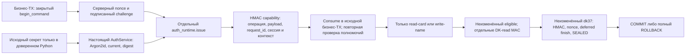
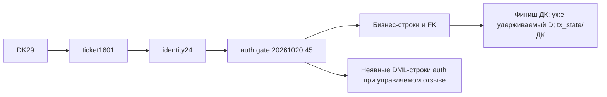

# Техресурс — шаг 45: доказательство команды и семантика отзыва

Дата: 20.10.2026, Asia/Yekaterinburg. Проект C:/Projects/excel-ai-agent-8001.
Рабочая БД/схема: ai_excel_agent_test/test_construction_identity_stage46.

**Только изолированное исследование. Исходный bearer исключён из нового бизнес-SQL; доказательство намеренно рассматривается как ограниченная capability, а не как несекретный флаг. Сериализованный отзыв означает упорядочивание завершений, не мгновенную отмену. Рабочее внедрение не выполнено.**

## Исходная граница и метод

Прочитаны установщики, тесты и отчёты шагов 42–44, актуальный AuthService и контракт единственного eligible(). До изменений сняты READ ONLY отпечатки всех 41 рабочей таблицы, SHA256 232 рабочих файлов и старых прототипов, исходные документы, порт/PID 8001. Старые контроли остаются в отдельных временных БД. Проверка шага 44 с исходным bearer повторяется только там: отсутствие bearer в новом контуре не выдаётся за его отсутствие во всех исторических контролях.

Новые БД auth_stage3_tx_closed_auth_proof_* создаются только в собственном временном PostgreSQL 18, с независимым портом/конфигурацией/секретами. Вторая peer-копия наследует тот же авторизационный ключ и схему: отрицательный перенос между ними нельзя объяснить только разными ключами. Реальные аккаунты/кадровые сведения не используются. Прикладные роли только SYSTEM_TECHNICIAN/OFFICE_MANAGER; никаких новых HTTP-прав/маршрутов.

## Доверенные компоненты и протокол

1. begin_command принимает одну из двух точных операций, типизированный JSONB payload, UUID request_id и короткий TTL (0,1–15 секунд). Сервер создаёт непредсказуемый UUID nonce и закрытую строку state по top-level txid. В одной живой ветви TX допускается только один command-domain. Для обеих команд на сервере разрешён только READ COMMITTED; REPEATABLE READ/SERIALIZABLE отвергаются до допуска, чтобы read не использовал старый снимок полномочий. При read нет D/T/I; при write ранний enter берёт D→T→I. Serialized-режим также получает G до бизнес-строк.
2. Challenge связывает версию/purpose, имя и OID БД, PID, top-level txid, nonce, операцию, канонический payload, request_id, режим серверной политики и целочисленные времена issued_ms/expires_ms. HMAC с префиксом challenge45 подписывает серверное jsonb::text. Это не доверие к клиентской копии полей.
3. Доверенный Python получает исходный секрет и вызывает настоящий AuthService.current. В SQL передаёт лишь его digest на отдельном auth_runtime-соединении. issue независимо проверяет подпись challenge, целевую БД/срок/политику и существующую сессию/пользователя/сотрудника/роли/разрешения. Ответ содержит исходный context плюс session_id/user_id/credential_version и HMAC capability45. Исходный секрет не попадает ни в выдачу бизнес-команды, ни в её календарные помощники.
4. Consume требует точное совпадение с закрытым state именно этой TX/PID, правильный HMAC, срок, операцию, payload, request_id и актуальные полномочия. Только после этого помечает capability использованной и выполняет фиксированную запись/чтение. Клиентские actor/role/GUC/permission-флаги не используются. Подпись чужой role-claim не заменяет серверную проверку таблиц полномочий.
5. Внешний COMMIT записи по-прежнему требует правильного независимого signed intent ДК. Наличие capability не позволяет сформировать HMAC ДК, пропустить finish, удалить ДК напрямую или снять SEALED.

Ключ авторизации — отдельные случайные 32 байта, созданные supervisor независимо от ключа ДК. Он хранится только в закрытой auth_proof.key под NOLOGIN auth-owner; в worker не передаётся. Выдача и проверка используют PostgreSQL pgcrypto HMAC-SHA256, фиксированные цели подписания и сравнение всех 32 байт. Отсутствие авторизационного ключа вызывает явный fail-closed, без NULL-MAC/резервного разрешения. Ключ ДК остаётся у прежнего dk-owner и доверенного календарного Python. Владельцы не получают ключи друг друга.

Время подписи — целые миллисекунды, не JSON float: исходная версия с дробным numeric не сохраняла точное текстовое представление после JSON-перехода. JSONB-канонизация здесь определена поведением PostgreSQL 18; кроссверсионная совместимость, key_id/ротация и независимый внешний формат ещё не доказаны. Входы не содержат SQL-имён, выражений или универсального execute.

## Две операции и независимость ДК

| Операция | Прикладные права | Запись |
|---|---|---|
| employee_read(eid,request_id,proof,mac) | Обе роли с data.read | Карточка id/full_name/position_id/phone; восемь источников не меняются |
| employee_name(eid,name,request_id,proof,mac) | Только SYSTEM_TECHNICIAN с data.update | Только full_name/updated_at; непустое имя, наличие сотрудника и отсутствие дубликата |

Нет смены должности, экипажа, архивирования, удаления, подтверждения/аннулирования билетов и ручного ДК. OFFICE_MANAGER остаётся только читателем/экспортёром в согласованной HTTP-модели. Будущие кадровые функции не реализованы.

Прямые старые auth_command/closed_write и dk_service-входы у бизнес-роли в новой копии закрыты. Доступны только begin_command, две команды и фиксированные помощники подготовки ДК. CalendarConnection/CalendarCursor переводят два точных SQL-запроса исходного eligible в тот же CALENDAR_SELECT и запрос отсутствий. Второй календарный алгоритм не появился.

Чтобы утечка capability не расширялась до произвольного чтения календаря, snapshot/calendar_row/absence дополнительно требуют MAC доверенного календарного компонента: отдельный префикс read45, точный auth-context, тип запроса, employee_id/дата. Он вычисляется с ключом ДК, а не ключом авторизации. Сервер проверяет его через закрытый dk_service.check45_read, не раскрывающий ключ. Подделать этот permit HMAC-значением capability нельзя. Реальные dk37.prepare/register, контекст девяти таблиц, nonce и finish/SEALED не менялись.

Запись request ledger остаётся атомарной с ФИО/ДК. Точный повтор request_id требует нового допуска/доказательства в новой TX и возвращает прошлый результат без повторного source DML. Изменённый payload того же user/request_id отклоняется 22023. Подпись старой TX для этого повторного запроса непригодна.

## SQL-роли и граница доверия

| Роль | Фактический доступ | Чего нет |
|---|---|---|
| Business closed_* | Именованные auth_proof-входы; USAGE схем; обычное чтение системной метаинформации | Прямых SELECT/DML 41 бизнес-таблицы, доступа к auth-таблицам/ключам/state, выдачи доказательств, advisory EXECUTE, CREATE/TEMP, членств/SET ROLE владельца |
| Новый auth_runtime_* | SELECT auth_users/sessions/roles/permissions/membership; только id/is_archived employees; INSERT нужных столбцов sessions/security_events и их sequence USAGE; UPDATE(password_changed_at) для настоящего FOR UPDATE логина; bigint advisory для rate limit; issue/revoke_user_sessions | Бизнес-DML/ФИО, прямого UPDATE revoked_at, DELETE сессий, ключей/служебного state, begin/consume/business-команд, управления политикой и block/version/roles |
| NOLOGIN auth-owner | Ключ/nonce/state/policy авторизации; проверка сессий; узкие UPDATE auth-состояния и DELETE назначений ролей для закрытых админских функций; G | Бизнес-DML и ключа ДК |
| NOLOGIN write-owner | Прежние минимальные business-права и фиксированные календарные чтения; consume/admitted_context; dk37 snapshot/register и проверка read-MAC | Ключа авторизации/ДК и прямого удаления ДК |
| NOLOGIN dk-owner | Прежний dk37-ключ/state/очистка, новая узкая проверка read-MAC | Ключа авторизации, прикладного LOGIN |
| Fixture/admin | Только тестовые setup/cleanup, смена политики и управляемые block/version/role-revoke | Не является недоверенным runtime; произвольное использование этой роли не входит в гарантию |

PUBLIC/EXECUTE закрыты для новых функций/схем; SECURITY DEFINER имеют фиксированный search_path с pg_temp последним. В новой БД явно закрыты PUBLIC CONNECT/TEMP, роли не SUPERUSER/CREATEDB/CREATEROLE/REPLICATION/BYPASSRLS, без членств. Бизнес-роль не может выбирать сильные row/table locks или системные advisory-функции.

AuthService.login/hash_password/current/digest/revoke_all производственного кода не менялись. Тестовый connect выдаёт только собственный auth_runtime, проверяя имя БД. Узкий тестовый AuthConnection переводит ровно существующий UPDATE revoke_all в фиксированный revoke_user_sessions; события по-прежнему пишет настоящий AuthService. Это фиксированный адаптер, не произвольный SQL внутри SECURITY DEFINER. Создание пользователей/роли остаётся подготовкой fixture, но логин, проверка сессии, выдача capability и отзыв не исполняются её полномочиями.

**auth_runtime — доверенная власть авторизации.** Её компрометация позволяет читать auth-данные, создавать сессии и выдавать proof для существующего разрешённого пользователя. Минимизация убирает прежний доступ fixture ко всем бизнес-таблицам, но не делает компрометированный issuer безопасным. Не заявляется, что секреты этой роли можно выдать SQL-кандидату. Её реквизиты/соединения должны быть отделены от бизнес-runtime. Владельцы, ОС, superuser и доверенный календарный signer остаются за границей угрозы произвольного business-SQL.

## Capability при раскрытии: допустимые последствия

| Где злоумышленник получил proof+mac | Что возможно |
|---|---|
| Только журналы, другая TX/соединение/БД | Воспроизведение отвергается контекстом; исходного bearer/digest сессии в proof нет |
| Исходное живое соединение, неиспользованная capability, срок ещё не истёк | Можно первым выполнить ровно уже разрешённую операцию с тем же payload/request_id; это ограниченный bearer |
| Исходная TX, но другая карточка/ФИО/операция/request_id/actor | Отказ; MAC и сравнение закрытого context не совпадают |
| После успешного consume | Повтор отвергается; нельзя получить вторую запись в выжившей ветви TX |
| После ROLLBACK TO до consume, но после challenge | Та же точная попытка может быть выполнена заново до expiry: прежние изменения/ledger/used откатились вместе |
| После ROLLBACK TO до challenge и нового begin в той же top-level TX | Новый nonce; старое доказательство непригодно даже при прежнем PID/txid |
| Прочитаны proof/параметры журналов | Видны payload, идентификаторы и служебные времена. Конфиденциальность ФИО/метаданных этим протоколом не обеспечивается |

Одна capability означает одно зафиксированное действие/живую ветвь, а не необратимое потребление при любом откате. Нет скрытого нетранзакционного одноразового счётчика. Если требуется запрет даже повторения полностью отменённой попытки, нужна отдельная durable reservation/иная семантика; это не реализовано.

Expiry ограничивает допуск, но не время уже начатой TX: после consume команда и обслуживание могут завершиться позже. 15 секунд — номинальный экспериментальный верхний TTL; проверка длительности challenge допускает до 100 мс на его формирование. Это не согласованный эксплуатационный норматив и не лимит удержания lock.

## Сравнение вариантов отзыва

| Вариант | Гарантия | IMMEDIATE → отзыв → COMMIT | Ограничения/циклы |
|---|---|---|---|
| Admission cutoff | Уже допущенная команда может завершиться; до consume актуальность проверяется | Отзыв может COMMIT раньше бизнес-COMMIT, который всё равно успешен — явно принятая для этого режима семантика | Нет нового G; нужен договор с UI, что начатые команды могут завершиться |
| Поздний MVCC/deferred check шага 44 | Отказ, если отзыв виден снимку последней проверки | Ранний IMMEDIATE переносит последний check; поздний отзыв не отменяет запись | Не даёт обязательной проверки в физической точке COMMIT; новые auth-row locks нельзя добавлять без графа |
| Сериализованный G | Управляемый отзыв и допущенная команда имеют общий транзакционный порядок | G остаётся после IMMEDIATE; отзыв ждёт; бизнес-COMMIT/ROLLBACK освобождает G, затем фиксируется отзыв | Отзыв ожидает, а не мгновенно отменяет. Общая очередь и idle-TX/DoS. Гарантия только для охваченных G путей |

В новом интерфейсе нет обещания финального auth-callback в COMMIT. Выбраны чёткие admission/serialization-семантики. В serialized режиме точка допуска — успешный consume под уже удерживаемым G после проверки сессии/прав. Если отзыв закоммитился до G/consume, допуск запрещён. Если команда раньше взяла G и допущена, отзыв не может успешно закоммититься до её завершения. Инициирование запроса отзыва не равно его COMMIT и не равно немедленному лишению выполняющейся команды прав.

Режим задаётся закрытой серверной policy, а не разрешением клиенту выбрать более слабое поведение. begin/issue/consume сверяют её. В испытаниях policy меняет только trusted fixture/admin перед сценарием; business/auth_runtime такой EXECUTE/UPDATE не получают. Рабочая политика по-прежнему требует отдельного согласования.

G охватывает revoke_user_sessions, block_user, bump_credentials и remove_user_roles данного прототипа. Прямые административные UPDATE, изменения auth_role_permissions, уничтожение аккаунтов, неизвестные писатели и будущие кадровые/архивные команды должны войти в общий контракт отдельно. Естественное истечение сессии/доказательства не является ожидающим G отзывом и не отменяет уже допущенную команду задним числом.

## Граф блокировок

Write: D→T→I→G→business rows, затем прежний finish с уже удерживаемым D. Read в serialized берёт G без D/T/I; закрытый one-domain state запрещает превратить его в пишущую TX. Управляемые auth-админские функции берут G до своего UPDATE/DELETE и не запрашивают D/T/I. Нет новых явных FOR UPDATE/SHARE auth-строк в бизнес-команде; DML-отзыв неизбежно получает собственные обычные строковые lock.

AuthService.login отдельно получает sorted bigint rate-limit lock и auth_users FOR UPDATE; его TX не запрашивает G/D/T/I и завершается до отдельного revoke. Если произвольный SQL trusted auth_runtime/admin удержит auth-строку, а потом начнёт ждать G, появится потенциальный цикл R_auth→G против G→R_auth административной функции. Это ограничение всех составных вызовов/доверенных инструментов, не исправленное «ранним DK». Не следует соединять login/revoke/business в одну внешнюю TX.

Relation/FK/unique locks PostgreSQL не объявляются исчезнувшими; DDL и другие привилегированные писатели не охвачены. Наблюдение pg_locks показывает ожидания, но не доказывает полного отсутствия всех удерживаемых tuple lock.

Свойства transaction advisory и отката описаны [PostgreSQL 18 Explicit locking](https://www.postgresql.org/docs/18/explicit-locking.html); раннее исполнение constraint triggers — [SET CONSTRAINTS](https://www.postgresql.org/docs/18/sql-set-constraints.html). Это основание протокола, не замена его конкурентным тестам.

## Журналирование

Параметризация не скрывает capability от PostgreSQL. Отдельная проверка включает log_parameter_max_length_on_error=-1 и намеренно вызывает ошибку с действительным proof/mac в bind-параметрах. В логах обнаруживаются nonce и MAC. Настоящий session bearer в эту проверку не передаётся. Затем проверяется, что раскрытое доказательство не переносится в другую TX/БД и не позволяет изменить payload, но позволяет ровно исходную команду в её собственном неиспользованном контексте.

BusinessConnection перед каждым execute проверяет отсутствие двух текущих исходных bearer в параметрах; календарные cursor-запросы также проходят через этот execute. Дополнительно после каждого нового теста выполняется поиск действительных токенов/пароля в postgres.log. Это доказательство поведения протестированных путей, не защита от компрометации Python/ОС или неизвестного мониторинга. Свойства журналирования описаны [PostgreSQL 18 Logging](https://www.postgresql.org/docs/18/runtime-config-logging.html).

Проверка guard является вспомогательным контролем repr параметров execute, а не универсальным сканером всех возможных программ/каналов. Архитектурно исходный секрет не включается в challenge/proof, а серверная проверка не доверяет этому Python-guard как полномочию.

Документ/records не содержат исходных токенов, паролей или ключей. Журнал намеренно содержит ограниченное доказательство и синтетический payload. Оно остаётся чувствительной информацией и не объявляется публичным. Временные роли/контекст перестают существовать после удаления собственного кластера. TLS/пулы/APM/автоматические EXPLAIN/сетевой перехват не испытывались; исходный bearer всё ещё существует в памяти доверенного auth-компонента.

## Подтверждённый остаточный блокер доступности

SQL-клиент с реквизитами business-роли может вызвать begin_command(serialized), **не получая доказательства и не предъявляя пользовательской сессии**, и удерживать D/T/I/G открытой TX. В ограниченном тесте TTL=0,1 с, ожидание 0,2 с, отзыв с lock_timeout=100ms получает **55P03**. Истечение challenge не освобождает transaction advisory lock. После ROLLBACK держателя отзыв успешно выполняется, ФИО и четыре ДК неизменны.

Это не анонимный доступ извне: нужны business-SQL credentials или исполнение SQL от этой роли. Но именно произвольный SQL этой роли входит в угрозу, поэтому результат существенен. Проверено лишь ограниченное ожидание, бесконтрольное зависание не запускалось. Отказ отзыва нельзя сообщать пользователю как успешный отзыв. Никакой fallback с обходом G не добавлен.

**Нельзя объявить прототип полностью защищённым:** он ограничивает подделку/перенос capability и даёт условный порядок фиксаций для управляемых writers, но оставляет DoS отзыва. Дополнительно unauthenticated begin может накапливать приватные строки state при многочисленных TX; квоты/retention не исследованы нагрузкой.

Альтернативы для отдельного согласования: выдавать challenge без D/T/I/G и получать ранние business-lock только после криптографической проверки capability с повторной проверкой под G; выполнять SQL через отдельный доверенный executor, не передавая его соединение клиенту; ограничить ресурсы/время транзакций и определить отмену/восстановление. Это предложения, не уже доказанный патч. Одна настройка proof TTL или statement_timeout не доказывает ограничение idle TX.

## Отмена уже выполняющейся команды: чего не доказано

Вариант «отзыв должен прервать уже начатую команду до согласованного checkpoint» не равен ожиданию G. Повторный MVCC-check шага 44 отменяет запись, только если увидел отзыв; ранний IMMEDIATE и интервал до COMMIT не исчезают. Строгая версия требует протокола кооперативной отмены/координатора, исключительного владения COMMIT и согласованной точки линеаризации. Такой прототип не реализован и мгновенная отмена не заявляется.

pg_cancel_backend не является доказательством отмены idle TX или уже завершившегося COMMIT; pg_terminate_backend также не заменяет установление исхода и идемпотентность. Эти права business/auth_runtime не выдавались. Наивное добавление auth FOR SHARE перед D даёт потенциальное R_auth→D против D→R_auth; добавление G после ранее взятых auth-строк даёт R_auth→G против G→R_auth. Обратные рёбра должны быть закрыты интерфейсами/границами TX либо приводить к отказу, а не скрываться retries.

## Готовность и оставшиеся вопросы

- Проверка ограничивает последствия раскрытия SQL-доказательства, но не делает безопасным захват исходной живой TX. Для исполнения без доступа недоверенного к этой TX возможен отдельный доверенный executor; это смена модели, не реализованная интеграция.
- Сериализация не является мгновенной отменой. Требуется согласовать admission cutoff либо порядок G, права админских писателей, последствия задержанного/неуспешного отзыва и сообщения UI.
- Все writers полномочий/архива/FK/DDL/импорта/retention пока не сведены в доказанный замкнутый рабочий граф. Auth-runtime — доверенный компонент, не новая недоверенная роль для пользователей.
- Общий G расширяет очередь и зависимость доступности от длительности TX; proof TTL не освобождает lock. Рабочие idle/transaction timeout, cancellation/retry и административное восстановление не внедрены.
- Пока нет key_id/ротации/recovery, безопасного retention key/state/requests/tx_state, cluster identity across restore, полноценного идемпотентного HTTP/file recovery и спецификации внешней канонизации.
- Read требует записи приватного nonce/state и поэтому не является полностью READ ONLY SQL-транзакцией, хотя не получает бизнес-DML и не меняет календарь. RO-экспорт/реплики требуют другого пути.
- Нагрузки/SLA, все 100 HTTP-сценариев, PDF/COM/VOУ, кадровые переводы/замещения и полный пользовательский HTTP/CSRF/Origin/пул не испытывались. Производственные алгоритмы не менялись.

## Результаты и сохранность

**Окончательный общий прогон: 170 успешных методов, 0 неуспешных.**
Каталог: `backend/output/security/auth_isolated/20261020T032451Z_4a0b66fe29564676913b34607a2dee25/`.

Состав: 1 BAT-preflight + 8 структуры + 11 сессий + 23 политик/запуска/кандидата + 16 старого HMAC/контролей + 20 dk37 + 4 lock-order-контроля + 20 закрытого интерфейса шага 42 + 28 авторизации шага 44 + **39 новых**. Это количество методов, не SQL-запросов, пользователей или отдельных конкурентных пар. Прежние наборы выполняются своими ограниченными ролями/копиями; не все 170 методов исполнялись новой бизнес-ролью.

### Результаты новых групп

| Методы | Проверка | Фактический результат |
|---|---|---|
| 01–02 | Две настоящие сессии; read обеим, write только инженеру | Разрешённые команды COMMIT; OFFICE_MANAGER не получает write capability |
| 03–04,11 | Подделка MAC/actor/session/version/challenge, иной eid/name/request_id/op | 42501; бизнес-изменений нет |
| 05–08,30–31 | Повтор использованного proof, другая TX/PID/БД, тот же PID с новым xid, тот же xid с новым nonce, expiry | Отказ; peer имеет тот же ключ, но не тот контекст |
| 09–10,32 | Отзыв/блокировка/credential_version/снятие роли до consume | Допуск запрещён; ФИО и четыре ДК сохранены |
| 12,25,28,37–38 | Реальные ACL/владельцы/PUBLIC/key separation/server policy | Нативные запреты; три владельца NOLOGIN; write-owner не читает ни один ключ, auth-owner не читает DK-key, dk-owner не читает auth-key |
| 13,15–18,26 | Независимость DK/read-MAC, raw COMMIT без intent, SAVEPOINT/SEALED, ошибка после реальной очистки | Подделка/пропуск отвергнуты; ошибка откатывает источник/ДК/state; корректная следующая TX удаляет только непригодный TRAVEL-ДК |
| 14 | Новый proof на точный повтор request_id / изменённый payload | Повтор без повторного DML; конфликт 22023 |
| 19 | Admission: IMMEDIATE → закоммиченный отзыв → COMMIT | Команда COMMIT — ожидаемая семантика допуска, не мгновенный отзыв |
| 20–22 | Serialized IMMEDIATE/DEFERRED, отзыв во время TX, ROLLBACK, отзыв до D | Отзыв ждёт G и фиксируется после завершения business-TX; либо новый допуск запрещён, если отзыв завершён раньше |
| 23 | Три писателя, два ждут D | Три COMMIT, 0 deadlock, четыре пригодных ДК сохранены |
| 24 | Реальный proof/mac в error-log; повтор из другого контекста; подмена | Proof/mac раскрываются; исходный bearer не передавался. Точная исходная команда в её живой TX возможна; перенос/подмена запрещены |
| 27 | Истечение proof после допуска | Не отменяет уже допущенную команду — явно проверенная граница TTL |
| 29,33 | Block/CV/role revoke через G во время serialized TX | Четыре управляемых изменения полномочий (с session revoke) ждут завершения команды; новых auth-row deadlock не наблюдалось |
| 34 | Отдельная fault-копия без auth-key | Явный 42501 Key unavailable; нет NULL-MAC/fallback |
| 35 | Неавторизованный пользовательской сессией begin держит G после TTL | **Подтверждён блокер доступности отзыва: 55P03** до освобождения TX |
| 36,39 | Серверная канонизация ФИО; неподдержанные снимки | Нормализация совпадает с consume; четыре read/write попытки в REPEATABLE READ/SERIALIZABLE отвергнуты 42501 |

В итоговых proof_records — 18 групп, включая матрицу ключей/владельцев, эффективные column/sequence/namespace ACL и счётчик business-execute без передачи исходных bearer. Нативный доступ к ключам/state/опасным функциям проверен для business и auth_runtime, а не заменён Python-моком.

Новые конкурирующие клиенты используют lock_timeout=3 с, statement_timeout=7 с, connect_timeout=3 с; наблюдение pg_locks 2,5 с, Event 3 с, join 10 с. Негативный тест доступности задаёт 100ms отдельно. Все акторы завершились. Это защитные границы эксперимента, не неизменяемые ограничения злоумышленника и не SLA. Idle/transaction duration не ограничены доказательством.

Три business-писателя не дали 40P01. Старые независимые контроли шага 40 повторили **12 ожидаемых deadlock** в 16 парах (четыре остальных — обычные ожидания); их не объявляют исправленными из-за успешных test expectations. Шесть прежних закрытых пар шага 42 вновь завершились без этих циклов. Новые G/R_auth/административные сочетания, описанные как потенциальные, этими контрольными парами не становятся подтверждёнными.

**Методы 19,24,27,35 со статусом ok подтверждают ограничения, а не устраняют их.** Отсутствие нового deadlock в перечисленных расписаниях не доказывает полноты общего графа всех писателей.

### Промежуточные прогоны: точные статусы сохранены

| Каталог auth_isolated | Всего | Успешных | Неуспешных | Объяснение |
|---|---:|---:|---:|---|
| 20261020T025555Z_bbed0cab646f4cdda1b977945a9b0d2e | 158 | 144 | 14 | 2 MAC-отказа на легитимном JSON context: дробный numeric не сохранял канонический текст при JSON float roundtrip; после ошибки до finally тест оставлял соединение с D, 12 следующих fixture-операций получили ограниченный lock_timeout |
| 20261020T030414Z_5106fafeebbc4768952d8aae9a703a42 | 164 | 133 | 31 | 29 ошибок и 2 assertion failure: неуточнённый policy.mode конфликтовал с PL/pgSQL параметром; часть расписаний не дошла до ожиданий |
| 20261020T031101Z_44b2aa55f1b34669ae522ad3e14028b0 | 36 | 36 | 0 | Только новый набор после alias/канонизации/строгой проверки отсутствующего ключа; отдельное воспроизведение DoS |
| 20261020T031321Z_5cecc90367814676b3afbbb4cab750fa | 167 | 167 | 0 | Полный набор со старым контролем и 36 новыми |
| 20261020T031902Z_cdc181f66d664ca8814707b97bab4894 | 38 | 37 | 1 | Дополнительный owner-аудит использовал regclass-cast приватной auth_command без USAGE у fixture; это диагностическая ошибка, доступ к схеме не расширен |
| 20261020T032226Z_7013d8d223ed44a99e46622fbc84192f | 2 | 2 | 0 | Только исправленные два новых каталожных ACL-аудита через pg_class/pg_namespace |
| 20261020T032451Z_4a0b66fe29564676913b34607a2dee25 | 170 | 170 | 0 | Окончательный полный набор: 39 новых, включая владельцев и обе команды с обязательным READ COMMITTED |

Failed-отчёты не переписаны. Исправления ограничены новым экспериментом и диагностикой. Время стало целочисленным, поля policy квалифицированы, тесты закрывают свои business-соединения и при ранней ошибке; метаданные читаются без новых grants fixture. Отдельно статический аудит обнаружил необходимость явного отказа при отсутствующем auth-key вместо NULL-результата HMAC; окончательная fault-копия проверяет fail-closed. READ COMMITTED явно проверяется не только пишущим enter, но и read begin/consume. Блокер доступности отзыва не исправлялся и не маскировался.

### Артефакты и изменения

Новые:
- backend/scripts/auth_command_proof_prototype.py — изолированный установщик/два фиксированных command-входа/адаптер канонического календарного чтения;
- backend/tests/test_auth_command_proofs.py — 39 новых методов;
- backend/docs/auth-step45-proof-revocation-2026-10-20.md — настоящий отчёт.

Изменены только scripts/run_auth_isolated.py и scripts/auth_test_worker.py: opt-in AUTH_STEP45_PROOF=1 при включённых stage42/44; создание основной, same-key peer и key-missing fault-копий; отдельная auth_runtime/NOLOGIN auth-owner; focused/owner-audit режимы и обезличенные records. AUTH_STEP40_LOCKS=1 включает отдельные старые контроли. Нагрузочный режим не включался. Производственные файлы, AuthService, eligible/ЛУВР/матрица/ВОУ, старые прототипы и launcher не менялись.

В окончательном каталоге сохранены report.json, tests.txt, step45_proof_records.json, step44_control_records.json, postgres.log/tools.log и worker.stderr.log. Каталог preflight: `backend/output/security/auth_step45_preflight_20261020T024904Z/`, before.json/verification.json содержат исходные/итоговые 41 отпечаток, 232 SHA256, состояние порта/PID, результаты семи прогонов и хеши новых файлов. Авторизационный ключ не передавался worker; временные пароли передавались stdin и редактировались в stderr. Журналируемая capability намеренно сохраняется как доказательство диагностического риска, без исходного bearer тестовых пользователей.

### Сохранность и остановка

Во **всех семи прогонах** количества и канонические READ ONLY отпечатки всех 41 рабочей таблицы до/после совпали. Итоговый срез также совпал с исходным preflight всего шага. SHA256 всех **232 зафиксированных рабочих файлов**, включая production/static/launcher/старые прототипы, совпали; исходные обследованные документы неизменны. Прежние пользовательские git-изменения не отменялись, чистота git не заявляется.

Все семь собственных кластеров остановлены/удалены вместе с их БД/ролями/ключами/тестовыми данными: cluster_removed=true, cleanup_errors=[]; собственные cluster-пути отсутствуют. Клиенты и акторы завершились. BAT/launcher-проверки общего окончательного прогона прошли в своих временных экземплярах; историческая первопричина сбоя шага 35 не объявляется установленной.

Сервер по-прежнему **127.0.0.1:8001, PID 728**, как в preflight. Он не перезапускался и не переключался на mandatory auth. Режим фиксируется по прежней точке запуска/main, неизменности соответствующих файлов и PID; новых HTTP-записей/авторизационных проб на живом сервере не было. Рабочие роли/grants/триггеры/данные и кадровые сведения не менялись; миграций/нагрузки/реальных аккаунтов/8000/Tunnel не запускалось. Историческое замечание construction_objects остаётся открытым.

**Итог: два блокера шага 44 строго ограничены в испытанной модели — raw session bearer исключён из нового бизнес-SQL, а сериализованный режим задаёт определённый порядок управляемого отзыва и команды, сохраняющийся после IMMEDIATE. Мгновенная отмена не реализована. Раскрытие capability остаётся опасным в её исходной живой TX; подтверждён DoS отзыва через begin без пользовательского допуска. Безопасность полного рабочего контура не доказана, к внедрению — НЕ ГОТОВ. Альтернативы предложены без внедрения. Шаг 45 окончен; к HTTP/следующему этапу автоматически не переходить.**
