# Техресурс — перевод сотрудника: проект и изолированный прототип

Дата: 20.10.2026. Проект C:/Projects/excel-ai-agent-8001.
Рабочая БД/схема: ai_excel_agent_test/test_construction_identity_stage46.

**Подготовлены модель истории, план переноса, полный найденный реестр зависимостей, SQL-прототип и интерактивный макет. Окончательный прогон: 32 выполненных теста, 0 ошибок/пропусков. Рабочая система не изменена. Образец не подключён к eligible/HMAC/HTTP и не версионирует свойства справочника. К рабочему включению не готов.**

## Область результата

| Статус | Содержание |
|---|---|
| Существующее приложение | employees.position_id, текущий справочник, whole-record PATCH, нынешние расчёты/факты/назначения. Истории должностей нет |
| Прежние эксперименты | Закрытые функции 42, авторизация 44, доказательства 45; их результаты не означают готовность кадровой команды |
| Новый прототип | Синтетическая схема hr собственного временного PostgreSQL 18: журнал, периодная проекция, idempotency/version, чтение и закрытые SQL-права |
| Макет | Автономные HTML/CSS/JS; синтетические данные только в памяти страницы, без HTTP. Переключение вида роли не является авторизацией |
| Будущая реализация | Версии определений должностей, общий датированный loader, новый контекст ДК, пользовательская авторизация, все отчёты/экспорты и согласованная миграция |

Это дополнение к кадровому проекту 43, а не автоматический следующий этап интеграции после 45. Новые кадровые HTTP-маршруты и рабочие миграции не созданы.

## Фактическая модель и зависимости

READ ONLY каталог: 41 таблица, 57 FK, 19 пользовательских триггеров. employees содержит position_id, crew_id, ФИО/контакты, nrs_number, max_shift_days/max_off_shift_days, dismissal_date, is_archived/archived_at и timestamps. Истории основных должностей, временного замещения и личной кадровой категории нет.

positions содержит name, action_description, specialty, work_location, work_schedule, report_description, aos_description, requires_daily_report, planned_count, equipment_description и timestamps. **Признака active/archived нет.** Нельзя фильтровать «действующие» должности по несуществующему полю: нужны правила доступности на дату и отдельное закрытие должности для новых назначений. Синтетический active в образце — фикстура будущего правила, не существующее рабочее поле.

employees.position_id → positions использует ON DELETE SET NULL, а production_control_mode_positions → positions — RESTRICT. Историю нельзя строить на физическом удалении должности: ID/определения сохраняются, доступность новых назначений меняется отдельно. Новых прав DELETE прикладным ролям не предлагается.

Производственные категории находятся в фактах/назначениях/корректировках и object_categories; это не персональная квалификационная категория. Перевод сохраняет все существующие категории. Если требуется ещё личная категория, её смысл утверждается отдельно; новое поле не добавлено молча.

[Реестр зависимостей](personnel-position-dependencies-2026-10-20.md): 171 прямое место/49 файлов; расширенный поиск — 533 места/117 файлов, включая косвенные параметры календаря и DTO. Отдельно разграничены runtime, CLI, старые миграции, clean-start public и экспериментальные функции. Это не доказательство отсутствия внешнего SQL/АОС-инструмента.

Особый обход: update_employee безусловно устанавливает position_id/crew_id/phone; employee_absences.js повторно отправляет их при изменении другого поля. После начала истории обычный PATCH не должен менять должность. Одной новой кнопки для этого недостаточно; старые writers нужно заменить при согласованном переключении. Сейчас код не менялся.

## Модель хранения

Основной источник — append-only журнал кадровых команд. Периоды строятся по последним неотменённым редакциям. Дата действия — date кадрового календаря Asia/Yekaterinburg; recorded_at — timestamptz. Когда изменение действует и когда оно стало известно системе — разные координаты.

| Предлагаемая структура | Поля и назначение |
|---|---|
| employee_position_observations | employee_id, observed_at/known_on, observed_position_id nullable, effective_start_unknown, источник/batch. Наблюдение исходного состояния, а не выдуманная дата вступления |
| employee_position_commands | root_id/revision, employee_id, TRANSFER/CORRECT/CANCEL, position_id/effective_on, reason, authenticated_actor, recorded_at, request_id, expected_timeline_version, previous_revision. Исходные редакции сохраняются |
| employee_position_timeline_state | employee_id/version: сериализация редакций и защита устаревшей карточки |
| employee_main_position_periods | Производная проекция [known_from,known_to), position_id/definition_version, ссылка на команду и признак неизвестности фактического начала |
| position_definition_versions | Датированные name/specialty/location/schedule/action_description/report_description/aos_description/requires_daily_report/equipment; известность начала и журнал исправлений. Часть справочника должностей |
| employee_acting_assignments | Отдельные acting_position_id/период/основание и правила распределения ресурса; не замена основной истории |

В прототипе сокращённые имена hr.baseline/head/events/requests/current_orders/periods. Это не утверждённые имена миграции. Версии справочника и acting_assignments здесь **не созданы**.

Если дата начала исходной должности неизвестна, нельзя использовать employees.created_at, первое движение, условное 01.01 или minus infinity. Сохраняются ID/NULL должности, точный момент наблюдения и effective_start_unknown=true. До известной точки resolver возвращает UNKNOWN_HISTORY. Известное наблюдение с position_id=NULL даёт отдельный UNKNOWN_POSITION; это не вывод об отсутствии трудовых отношений.

known_from — начало участка подтверждённых сведений, **не фактическая дата первой должности**. На известном участке на employee/date выбирается не более одной основной должности; при известных сведениях — ровно одна. На D предыдущая действует до D исключительно, новая с D включительно. UI показывает старый период по D−1. Будущий перевод не заменяет сегодняшнюю должность.

В образце периоды — view с lead(known_from), без прямых записей интервалов. Уникальность действующих точек проверяется закрытой командой под D; журнал старых редакций не имеет ошибочного UNIQUE(employee,effective_on), который запретил бы исправления. Если полный проект материализует периоды, нужна собственная проверка непересечения, например EXCLUDE(employee_id =, daterange &&) с btree_gist, и отдельно проверка пробелов. [PostgreSQL: ограничения диапазонов](https://www.postgresql.org/docs/18/rangetypes.html).

## Команда и сохранность остальных данных

Будущий именованный вход: personnel.transfer(employee_id,new_position_id,effective_on,reason?,request_id,expected_timeline_version). Сотрудник берётся из карточки, но сервер проверяет его заново. Нет произвольных SQL/имён полей, role/user_id флагов или присылаемого вместе crew/category. Начальная должность нового сотрудника — отдельный контракт, не transfer.

Проверки: настоящая сессия и точное право, допустимый сотрудник, доступная должность на дату, непустая дата, expected_version, отсутствие конфликта даты/эквивалентного перевода, действующие будущие планы, request_id/payload, допустимость ретродаты и impact на расчёты. Архив/увольнение не отменяются переводом автоматически. Правила переноса после даты увольнения и оформления до найма требуют отдельного решения.

Одна внешняя TX должна атомарно содержать допуск, повторную бизнес-валидацию, журнал/проекцию/ledger и новую независимую проверку ДК. Ожидание человека, UI-preview, PDF/Excel находятся вне TX. После lock версия и последствия проверяются снова.

Перевод не пишет crew_id, категории, привязки к объектам, назначения, исходные движения/билеты/факты/коды ЛУВР, dismissal_date и max_shift_days/max_off_shift_days. Не создаёт увольнение, новый заезд или билет. Категория и экипаж меняются только отдельными разрешёнными операциями. Это сохраняет исходные данные, но не обещает неизменности производного отчёта после исправления кадровой истории.

**Граница графика:** сегодня SHIFT/FIVE_TWO и OBJECT/OFFICE берутся из positions. Выбор другой должности может косвенно изменить календарь, даже без записи движений/лимитов. До согласования такие переходы должны явно отказываться или требовать отдельного решения о датированной политике рабочего режима. Нельзя объявить «ротация сохранена», просто не записав max_shift_days. Образец не моделирует графики и не доказывает этот инвариант на рабочем календаре. Также нужны правила для specialty/requires_daily_report/GEODETIC; факты нельзя удалять ради совместимости с новой должностью.

Idempotency: (реальный actor,request_id) + канонический payload. Точный повтор возвращает исходный результат без нового события; иной payload даёт конфликт. expected_version — условие первой попытки, а не часть идентичности уже проведённой операции. Актуальная авторизация проверяется и при повторе. Ledger фиксируется вместе с историей; при неопределённом COMMIT сначала запрашивается результат, а не создаётся новый UUID.

## Ретродаты, исправление и отмена

В известном участке ретроперевод может вставить точку между существующими, не сдвигая следующий будущий план. Нужен impact-preview от новой даты до следующей границы: затронутые ДК/отчёты/назначения/архивы. Версия и impact повторно проверяются под lock. Образец проверяет временные границы, но не реальный impact рабочих отчётов.

До даты первичного наблюдения и на саму эту дату обычный transfer образца отвергается 22023. Для более ранних сведений нужен отдельный документированный импорт истории/уточнение baseline; не «перевод задним числом» с выдуманной предшествующей должностью. Он не реализован и не разрешён роли автоматически.

CORRECT и CANCEL — новые редакции с причиной, автором, target/root и expected_version. Старую команду не удаляют и не переписывают. CORRECT меняет действующую интерпретацию даты/должности; CANCEL исключает точку из текущей проекции, сохраняя её в audit. Отмена среднего перевода продлевает предыдущую должность до следующего неотменённого плана. Отменённый root не восстанавливается скрыто. Реальный возврат в прежнюю должность с новой даты — новая TRANSFER, а не отмена прошлого факта.

Должны различаться «действует на дату D по нынешним сведениям» и «было известно при выпуске отчёта R». Журнал сохраняет исходные редакции, но API as_known_at и rebuild архива в образце не реализованы. Нужен регламент закрытых месяцев, согласования и перевыпуска; выпущенные файлы/UUID не перезаписываются.

Системотехнику разрешено проектируемое оформление перевода, но не выдано автоматическое право исправления/отмены. В образце review исполняется отдельной технической ролью только в собственном кластере; это не новая прикладная роль и не рабочий GRANT.

## Историчность справочника и отчётов

Один сохранённый position_id не защищает прошлое от изменения name/schedule/location/specialty/descriptions. **Тест 29 подтвердил блокер:** доверенная фикстура переименовала должность, resolver старой даты стал показывать новое имя; затем название восстановлено. Успешный тест означает обнаружение дефекта, а не готовую защиту.

Нужны датированные версии определений или неизменяемые снимки с доказанной применимостью на дату. Копия сегодняшнего имени при оформлении ретроперевода тоже не доказывает историчность. Неизвестные ранние свойства остаются неизвестными; политика выпуска отчёта должна это явно учитывать.

«Описание для АОС» и «Описание для отчёта» остаются в справочнике/его версиях. В производственную матрицу они **не добавляются**. Отчётный слой ВОУ/АОС/Расстановки получает определение на дату. planned_count также не имеет истории: кадровые периоды не делают автоматически историческим план штатной численности.

| Потребитель | Изменение будущего контракта |
|---|---|
| Карточка, поиск, билеты | current_position(today), планы отдельно; для документа as_of=report/event date, не дата загрузки |
| ЛУВР/Excel | Датированный общий loader, строки по периодам/role_kind, один canonical employee/day resource; monthly position_name недостаточно |
| Матрица | POSITION_RULE/basis_id/requires_daily_report/eligible-position по day; сохранить категории/объекты/факты, не переносить descriptions в DTO |
| Ежедневные/Word/промежуточные отчёты | report_date и датированный employee DTO; неизвестная дата — диагностика, не current fallback |
| Расстановка | target передать также в employee_details для report_description/equipment; crew/транспорт сохраняются, их собственная историчность — отдельный вопрос |
| ВОУ/пустые ДК-строки/АОС | pid/definition по каждому дню, версия в ключе группировки; разные должности/описания месяца не сливать. Внешний полный АОС-путь отдельно обследовать |
| Аналитика | Должность на day, headcount distinct employee/day, план штата отдельно; две строки одного человека не два сотрудника |
| Назначения/режим контроля | Проверять дату/отрезок; несовместимость показывать, не удалять подтверждённые назначения/факты |
| ДК | Новый подписанный контекст HR/справочника и тот же eligible через общий датированный loader; старая подпись девяти таблиц HR не покрывает |

## Перевод и временное исполнение обязанностей

Это две сущности и две команды. Acting хранит период [from,to), acting_position/определение/основание и правила учёта, не заменяет основную должность; окончание не создаёт обратный перевод.

Для И.О. Руководителя СК обязательна **отдельная строка ЛУВР на период замещения**. Это требование пользователя, а не найденная действующая функция. Основная должность сохраняется. На employee/day есть один канонический ресурс: FULL=1 нельзя записать по 1 в обе строки, HALF=0,5 также не удваивается. Сумма распределения не превышает доступный ресурс; точные доли/обозначение основной строки и пересечения замещений требуют согласования, автоматические 50/50 не назначаются.

Табельная строка не равна отдельному человеку. При пересечении перевода и acting-интервала последний сохраняется, а основной период меняется по дате. Замещение не выдаёт auth-роль, права руководителя на ДК или подтверждение билета. Его влияние на eligible/контроль ещё не определено. Acting-таблицы, команды и права в образце не создавались.

## Права, авторизация и граф транзакции

| Действие будущей системы | SYSTEM_TECHNICIAN | OFFICE_MANAGER |
|---|---|---|
| Карточка/история/разрешённый экспорт | Да | Да |
| Разрешённый перевод | Да после проверки пользователя и согласования интеграции | Нет |
| Категория/экипаж | Только отдельная уже разрешённая операция, не transfer | Нет |
| Исправление/отмена/импорт ранней истории | Регламент ещё нужен, автоматически не предоставляется | Нет |
| Удаление/подтверждение/аннулирование/ручной ДК | Прежние ограничения сохранены | Нет |

В новом образце нет настоящих прикладных сессий: personnel_tech/personnel_office — **модель SQL ACL**, не замена proof шага 45. session_user задаётся PostgreSQL-аутентификацией; GUC/параметр role/user_id не принимаются как полномочия. personnel_review — доверенная техническая роль испытаний, не новая прикладная роль. Реальные аккаунты не создавались. HTTP/CSRF/Origin/отзыв под новой HR-командой не испытывались.

Runtime LOGIN NOINHERIT без владения/членств/админских флагов, прямого SELECT/DML, CREATE/TEMP. Tech/Office получают EXECUTE resolve/history; Tech дополнительно transfer, Review — review. Private command недоступна всем runtime. Владелец функций personnel_owner — NOLOGIN, SELECT hr-отношений, INSERT events/requests, UPDATE(version) head; **нет UPDATE employees и прав ДК**. PUBLIC EXECUTE закрыт, search_path=pg_catalog,hr,pg_temp, CREATE в доверенных схемах запрещён. Системные advisory перегрузки закрыты PUBLIC только в своей БД, owner получает xact(integer,integer).

Прямые UPDATE employees, INSERT/DELETE событий, FOR SHARE, вызов I, SET ROLE owner, TEMP и private command получили 42501. Locking SELECT в PostgreSQL требует также UPDATE хотя бы одного столбца; в образце runtime не имеет даже прямого SELECT таблиц. [PostgreSQL: права](https://www.postgresql.org/docs/18/ddl-priv.html).

```mermaid
flowchart LR
 UI[Выбор и impact-preview вне TX] --> A[Будущая проверка пользователя и exact proof]
 A --> D[DK 20261017,29]
 D --> T[ticket 20261007,1601]
 T --> I[identity 20261013,24]
 I --> R[head сотрудника FOR UPDATE; expected_version]
 R --> J[Append command и ledger; проекция]
 J --> C[Будущий HR-контекст и тот же eligible]
 C --> H[Signed intent и серверный finish / SEALED]
 H --> E[Внешний COMMIT либо общий ROLLBACK]
```

В прототипе реально выполнен **D→T→I→head→events/requests**. T/I берутся консервативно всегда, FK проверяют синтетические employee/position; других конкурентных писателей справочника нет. Ветвь после журнала к HMAC — будущий контракт, не реализованный код. Ранний D без пользовательского доказательства может стать DoS-точкой шага 45; устранение этого блокера здесь не заявляется.

HR-история и версии справочника отсутствуют среди восьми source-триггеров/девяти хешируемых таблиц ДК. Полная реализация должна включить их в контекст/dirty/nonce/SEALED и новый protocol version, включая future-orders. Нельзя просто поставить transfer поверх старого COMMIT или обновлять employees.position_id по расписанию. Нужен единый датированный loader для того же eligible; SQL-дубликат календарного алгоритма запрещён. Нынешний eligible и старые прототипы не изменялись.

Авторизационный ключ независим от DK-HMAC. Доказательство будущего transfer связывает точную операцию/payload/request_id, БД/контекст, TTL/nonce. Нужны новые replay/logging/отзыв/SAVEPOINT-проверки. Шаг 45 оставил подтверждённую возможность удерживать admission-lock до предъявления доказательства; это блокер интеграции, а не готовая защита HR. Семантика отзыва и момент линеаризации также должны быть выбраны явно.

SAVEPOINT образца откатывает события/head/ledger; RELEASE не фиксирует внешнюю TX. В будущем после SEALED запрещены и HR-правки, DEFERRED не снимает запрет. В образце SEALED нет, соответствующие гарантии не испытывались. Освобождение lock при rollback-to учитывается по [документации PostgreSQL](https://www.postgresql.org/docs/18/explicit-locking.html).

## План переноса — не выполнялся

1. Утвердить cutover, доступность должностей, режимы SHIFT/FIVE_TWO/OBJECT/OFFICE, ретродаты/отмены и всех писателей, включая CLI/ручной SQL/АОС. Резервная копия и проверка восстановления — в отдельной среде.
2. В изолированной копии установить структуры/закрытые права. Для каждого сотрудника сохранить наблюдение position_id/NULL с точным моментом переноса, unknown_start=true, batch_id/контрольным хешем. Не выводить дату вступления из created_at/движений и не создавать фиктивную TRANSFER при backfill.
3. Справочник сохранить как наблюдения с неизвестной предысторией; новые изменения — датированными версиями. ID/ссылки не удалять, исторические ссылки не обнулять через FK SET NULL.
4. Подтверждённую документами раннюю историю загружать отдельным согласованным импортом. Неподтверждённые участки — UNKNOWN; подготовить coverage-report дат/NULL/недоступных определений и правила отчётного отказа/предупреждения.
5. Перевести **всех** readers на общий current/as-of, включая CALENDAR_SELECT/_inputs/policy, Word/Excel/ВОУ/АОС/Расстановку/аналитику. Сравнить копии без переводов; неизвестное прошлое не подменять current. Архивы не переписывать.
6. Доказать новый HR/DK-контекст и пользовательскую авторизацию. Затем закрыть whole-record PATCH, импорты, начальное кадровое создание и справочные обходы. Нельзя оставить старого писателя, который меняет должность вне журнала.
7. Испытать повторяемый migration_batch_id/employee_id, атомарный rollback, копии исходных фактов, неизвестный COMMIT и recovery. Не допускать смешанного режима «история пишется, часть readers остаётся current-only».
8. Отдельно согласовать рабочее переключение и rollback-план. После реальных переводов возврат к старым readers без конверсии несовместим. Сейчас ни миграция, ни scheduler, ни переключение не создаются.

Рекомендуется current_position(as_of) без ночного UPDATE. Старый employees.position_id в образце неизменен и не считается текущим после будущего transfer. Если в переходном периоде нужен cache, его контракт/атомарность отдельно доказать; два независимых источника истины недопустимы.

## Испытания и ограничения результата

Стенд с нуля в собственном PostgreSQL 18: три синтетических сотрудника/четыре должности, без копирования персональных строк. Crew и другие неизменяемые данные представлены crew_id и JSON-фикстурой категорий/назначений/перемещений/билетов/фактов/ЛУВР/ДК; проверяются после каждого теста. Это **не настоящие рабочие таблицы фактов/ДК и не исполнение их триггеров**.

| Проверки | Окончательный исход |
|---|---|
| 01–04,18,25: неизвестное начало, NULL position, future/backdate/границы | Корректное разрешение; до/на baseline отказ 22023; 14+17 календарных дат месяца без удвоения |
| 05–08,17,23: повтор/payload/version/коллизии | Повтор без события; изменённый payload 22023, одна дата 23505, stale 40001 |
| 09–11,14,19,20: ACL/search_path/read-only | Office не пишет; private/прямой SQL/lock-обход 42501; неизвестная/недействующая должность 23514 |
| 12–13,24,26–27,30–31: коррекция/отмена | Старые редакции остаются; причина обязательна; конфликт дат/target отказ; будущий следующий план сохраняется |
| 15–16,28,32: ошибка/SAVEPOINT/timeout | 22012 откатывает журнал/head/ledger; rollback-to позволяет повтор; 55P03 без частичной записи; неизвестный employee P0002 |
| 21: конкуренция одного employee | A COMMIT, B ждёт D без удерживаемых T/I, затем stale 40001 и ROLLBACK |
| 22: разные сотрудники | Два COMMIT; общий D всё равно сериализует |
| 29: блокер версий справочника | Переименование меняет историческое имя; затем фикстура восстановлена. Это подтверждение ограничения |

40001 здесь явно создаётся optimistic-version проверкой, не уровнем SERIALIZABLE. Образец использует стандартный READ COMMITTED. pg_locks у ожидающего показал только (20261017,29,granted=false). В двух новых расписаниях 40P01 не получен; это не доказательство невозможности всех циклов. Старые билетные/identity/admin-контроли не повторялись; нагрузки/p95/p99/SLA нет.

connect_timeout=3s, lock_timeout=2s, statement_timeout=5s; отрицательный lock_timeout=100ms. Наблюдение ≤1,5s, join ≤7s. Own cluster останавливается fast в finally и удаляется только после проверки абсолютных путей/остановки.

| Каталог personnel_isolated | Результат и статус |
|---|---|
| 20261020T034156Z_00f73ee095f14a8aab1dc19812d683e9 | Все 25 методов пропущены: import-time skip предшествовал configure. Старый runner ошибочно записал success=true; **исключён**, assessment.json accepted=false. Исходные журналы не переписаны |
| 20261020T034225Z_f173f3456cd642bebffb43ae5cb520dc | 25 выполненных, 0 failures/errors/skips; промежуточная серия |
| 20261020T034412Z_a4b07c4757c449a8a3f10bc05cada8a3 | **32 выполненных, 0 failures/errors/skips**; окончательная серия с отдельным подтверждением блокера test29 |

[Автономный макет](prototypes/personnel-transfer/index.html) использует скопированные текущие main/ui/employee CSS-токены. Обязательная дата, новая должность/текущая автоматически, необязательное основание, двухэтапное подтверждение, будущий период, просмотр Office и отдельное описание И.О. Production assets не менялись. Макет не выполняет настоящую авторизацию и SQL; коррекция/отмена в нём не реализованы.

Отдельный headless Chrome проверил future-transfer без смены сегодняшней должности, две стадии подтверждения, отказ до baseline, вид Office и отсутствие JS-ошибок/HTTP-запросов. Ширины 1440 и 390 — без горизонтального overflow. Снимки transfer-dialog.png, history-1440.png, history-390.png и browser.json сохранены; диалог просмотрен визуально. Временный браузерный профиль удалён; рабочие браузеры/серверы не использовались.

## Вопросы до дальнейшей реализации

- Действующая должность на дату, переходы разных графиков/мест, допустимость ретродат при увольнении/архиве.
- Личная категория, если нужна помимо производственных категорий; её смысл пока не определён.
- Кто исправляет/отменяет, закрытые месяцы, документы и перевыпуск, восстановление ранней истории.
- Версии справочника, UNKNOWN-сведения и исторический planned_count.
- Устранение admission-DoS шага 45, реальная пользовательская авторизация и выбранная семантика отзыва.
- Новый HR/DK-контекст/nonce/guards/SEALED, все direct writers и полный смешанный граф блокировок, FK/UNIQUE/retention/DDL.
- Неопределённый COMMIT, idempotency/recovery, retention ledger и воспроизведение as_known_at.
- Отдельная реализация И.О. Руководителя СК, распределение ресурса и пересечения с основной должностью.

Следующий согласованный этап: сначала версии определений/общий dated read-model в копии, затем HR/DK-контекст и авторизация, потом реальные репозитории/HTTP/экспорт. Включать запись до этого нельзя.

## Файлы и сохранность

Новые файлы: scripts/personnel_transfer_prototype.py, tests/test_personnel_transfer_prototype.py, tests/browser/personnel_transfer_preview.cjs, docs/prototypes/personnel-transfer/{index.html,style.css,preview.js,README.md}, настоящий документ и personnel-position-dependencies-2026-10-20.md (всё под backend).

Обследование: backend/output/security/personnel_transfer_20261020T033909Z/ — before.json, verification.json, dependencies.json, semantic_dependencies.json, browser.json и PNG. SQL-артефакты — backend/output/security/personnel_isolated/<run>/report.json, tests.txt, postgres.log/tools.log; первый прогон дополнен assessment.json, а не переименован в успешный.

READ ONLY сравнение до/после всего этапа: количества и канонические отпечатки **всех 41 рабочих таблиц совпали**. SHA256 всех **223 исходных контрольных файлов** совпали; дополнительные 117 файлов семантического обследования неизменны с момента чтения (наборы пересекаются, числа не складываются). Каталог столбцов, 57 FK и определения 19 пользовательских триггеров также совпали. Три собственных PostgreSQL-кластера остановлены/удалены вместе с БД, ролями, секретами и синтетическими данными; cluster_removed=true, cleanup_errors=[] во всех трёх отчётах. Первый пропущенный прогон отдельно исключён.

До/после прослушивается тот же **127.0.0.1:8001, PID 728**. Процесс не перезапускался/не переключался; обязательная авторизация не включалась. На живом сервере пишущие API не вызывались. Рабочие роли/grants/триггеры/кадровые данные не изменялись; реальные аккаунты, 8000 и Cloudflare Tunnel не запускались. Историческое замечание construction_objects не исправлялось. Проверены синтаксис Python/JS и автономный браузерный сценарий; это не новая проверка полного приложения.

**Рабочая миграция, перевод сотрудников и HTTP-интеграция не выполнены. eligible(), ЛУВР/матрица/ВОУ, протоколы 37/42/44/45 и launcher не менялись. Переводы и замещения в рабочей системе не включены. Остановка до отдельного согласования.**
